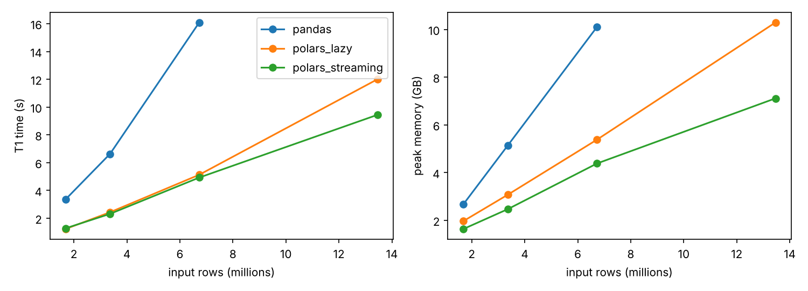
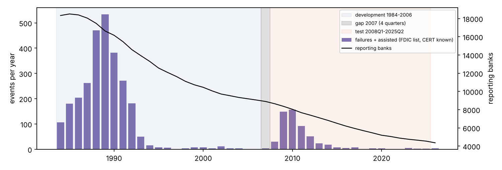
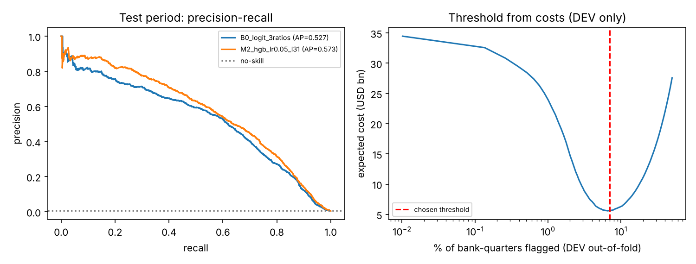

| | |
|----------------------|------------------------------------------------------------------------------|
| **Student** | Nguyễn Phan Anh — Student ID: `<fill in>` |
| **GitHub repository (public)** | `https://github.com/<your-account>/<repo-name>` |
| **Download method** | FDIC BankFind public API (`api.fdic.gov/banks`), script `src/s01_download.py` (adapted from the course starter); resumable, verified against the API's own row totals |
| **Download date** | 23 November 2026 (API index `risview_20261116221646`) |
| **Row counts** | Financials 1,682,738 bank-quarters (170 quarters, 1984Q1–2026Q2, 24,064 banks); Failures 4,117; Institutions 27,838; clean panel 1,681,643 |
| **Development period** | 1984Q1–2006Q4: 1,193,914 bank-quarters, **2,658 failing banks** (10,251 positive bank-quarters) |
| **Gap** | 2007Q1–2007Q4 (4 quarters, discarded) |
| **Test period** | 2008Q1–2025Q2: 435,446 bank-quarters, **558 failing banks** (2,181 positive bank-quarters), evaluated once |

**Abstract.** A supervisor's early-warning system is only as good as the data pipeline underneath it. Using 42 years of public US Call Reports, I build a reproducible pipeline that downloads, stores, audits, cleans and transforms 1.68 million bank-quarters on a laptop, and I measure every design choice. Parquet with zstd compression is 2.8× smaller than CSV and up to 84× faster to query; a single lazy Polars query builds the point-in-time panel 2.5× faster than idiomatic pandas with 25–33% less memory, and PySpark reproduces it row for row. The automated audit finds problems that would silently corrupt a model — year-to-date income items, capital ratios encoded as zero when missing, failed thrifts that kept reporting, and change codes that label failed banks as mergers. On a single, untouched test period (2008–2025, 558 failures) a gradient-boosting model reaches PR-AUC 0.573 (95% CI 0.534–0.608) against 0.527 for a three-ratio baseline, and a cost-based alarm that flags 2% of bank-quarters catches 94% of failing banks at least once before failure. It misses the 2023 liquidity-driven failures, which shows what public Call Report data cannot see.

# 1. Introduction and research questions

The State Bank of Vietnam wants to rank banks by failure risk. Because Vietnamese supervisory data are not public, the pipeline is built on the US FDIC data, which cover three crises (1984–1993, 2008–2012, 2023). The report answers three questions:

* **Q1.** How should four decades of bank reports be stored and processed on a laptop, and when would a Spark cluster be needed? (Sections 3 and 5)
* **Q2.** What quality problems do the raw data contain, and how does the pipeline handle them without look-ahead bias? (Section 4)
* **Q3.** Can the pipeline's output support an honestly validated early-warning model? (Sections 6 and 7)

The pipeline is ten scripts (`src/s01` … `s10`) run by `python run_all.py`; every table and figure below is written by those scripts to `outputs/` (file names given in brackets).

# 2. Data acquisition (Part 1)

**Source and scope.** All three tables come from the FDIC BankFind API: *Financials* (one row per bank `CERT` and report date `REPDTE`), *Failures* (failed and assisted banks with the loss to the deposit insurance fund, `COST`) and *Institutions* (static attributes and the last structural change code `CHANGEC1`). The scope is the course convention: all banks 1984Q1–2026Q2.

**Field selection.** I keep the 30 Call Report fields of the course starter (balance sheet, loan book, asset quality, earnings, PCA capital ratios) and add eight fields, each with a reason from the bank-failure literature (Cole & White, 2012): the real-estate loan breakdown (`LNRECONS`, `LNRENRES`, `LNREMULT`, `LNRERES`), because construction and commercial real-estate concentration drove the 2008–2012 failures; wholesale and core funding (`FREPP`, `OTHBOR`, `COREDEP`) for funding fragility; and intangibles (`INTAN`) to compute tangible equity. Every code was checked in the API field dictionary.

**Reproducible, resumable download.** `s01_download.py` pages through the API 10,000 rows at a time, with retry and exponential back-off. Each quarter is written as soon as it is complete, together with a manifest entry (rows, API total, time, API index name). A rerun skips quarters already marked complete, so an interrupted download resumes where it stopped. The full download took 836 s (14 min).

**Completeness verification** [`p1_completeness.json`]: for every one of the 170 quarters the number of rows equals the API's `meta.total`; there are 0 duplicate (`CERT`, `REPDTE`) keys; and the grand total, 1,682,738, equals a separate API count for the whole date range. The Failures (4,117) and Institutions (27,838) tables also match their API totals.

# 3. Storage layout (Part 1)

**Design.** The raw layer stores one Parquet file per quarter in a Hive-style folder (`raw/financials/REPDTE=19840331/part-0.parquet`), written with an **explicit Arrow schema** (`CERT` int32, `REPDTE` string, all amounts and ratios float64) and **zstd** compression. One file per quarter is what makes the download resumable and appendable: a new quarter is one new file, and nothing is rewritten. The clean layer is partitioned by year (43 files), sorted by date then bank.

**Measurement.** `s02_storage_benchmark.py` writes the same 1.68 M × 41 table in six layouts and times three typical queries with Polars (median of three warm runs) [`p1_storage_benchmark.csv`, Figure 1].

| Layout | Size (MB) | Files | Write (s) | Full scan (s) | 4 columns (s) | 4 cols, year 2008 (s) |
|------------------------------|----------:|----------:|----------:|----------:|----------:|----------:|
| CSV | 527.4 | 1 | 45.6 | 1.179 | 0.421 | 0.420 |
| CSV gzip | 203.7 | 1 | 252.1 | 1.777 | 1.714 | 1.590 |
| Parquet snappy, 1 file | 264.7 | 1 | 0.6 | 0.209 | 0.016 | 0.004 |
| **Parquet zstd, 1 file, sorted** | **190.1** | 1 | 0.9 | 0.281 | 0.020 | 0.005 |
| Parquet zstd, partitioned by year | 192.0 | 43 | 0.9 | 0.294 | 0.037 | 0.007 |
| Parquet zstd, one file per quarter (raw layer) | 239.3 | 170 | – | 0.278 | 0.044 | 0.006 |

{width=100%}

**Why Parquet beats CSV, from the numbers.**

1. *Size.* Columnar storage plus zstd makes the data 2.8× smaller than CSV (190 vs 527 MB). gzip-CSV is about as small, but it is 1.5× (Polars) to 6.5× (pandas) *slower* to read than plain CSV, and 5.5× slower to write than CSV (280× slower than Parquet), because it must be compressed and decompressed as a single stream.
2. *Projection.* Reading 4 of 41 columns takes 0.020 s from Parquet against 0.421 s from CSV (21×). Parquet stores each column separately, so the reader skips the other 37, while a CSV reader must parse every byte of every line.
3. *Predicate pruning.* The sorted file has 17 row groups, and their min/max statistics show that only one of them contains 2008, so the 2008 query reads about 6% of the file (84× faster than CSV). With year partitioning, the same pruning happens at the folder level.
4. *Types.* CSV loses the schema. When the CSV was re-read, `REPDTE` became an integer, `CERT` became int64, and `P3ASSET` became a **string**, because the field is empty for every row before 2001, so type inference saw only blanks [`p1_storage_extra.json`]. Parquet stores the types once, in the file.

Snappy is slightly faster to decode but 39% larger than zstd. Since the full panel decodes in under 0.3 s either way, I chose the smaller format. Partitioning by year costs nothing measurable in size or full-scan time, and it gives cheap appends and folder pruning when the panel grows. The one-file-per-quarter raw layer is 26% larger because of per-file overhead (the small-files problem). That is acceptable for an append-only landing zone, and it is the reason the clean layer is consolidated by year. In memory the panel takes 526 MB in Polars and 572 MB in pandas, a third of a laptop's RAM, which already suggests that no cluster is needed (Section 5).

# 4. Data quality and the point-in-time panel (Part 2)

## 4.1 Automated audit

`s03_data_quality.py` runs a fixed battery of 30 named checks plus a missing-value profile for every field and year. It writes a Markdown report [`outputs/dq_report.md`], a check table [`p2_dq_checks.csv`] and a missingness heat-map (Figure 2). Each check has an id; the fix in `s04_build_panel.py` cites the same id. The most important findings are below (the full table is in Appendix A).

| Id | Problem found | Extent | Handling (and why) |
|--------|--------------------------------------|----------------|--------------------------------------|
| F14 | Income items (`NETINC`, `INTINC`, `ELNATR`, …) are **year-to-date**: the median `INTINC` in June, September and December is 2.01×, 3.00× and 4.01× the March value | all flow fields | De-cumulate: Q1 = YTD; Qk = YTD_k − YTD_(k−1) **only** if the previous quarter of the same year was reported, else missing. Using raw YTD would make Q4 banks look four times as profitable as Q1 banks |
| F14b | YTD interest income falls within a year (restatements, mergers) | 2,235 bank-quarters (0.18%) | Negative quarterly interest income set to missing |
| F16–F18 | Risk-based capital ratios **encoded as 0 when not applicable**: `RBCRWAJ` = 0 for 100% of reports before 1990, and for 37% of reports since 2020 (community-bank leverage-ratio filers); `RBC1AAJ` = 0 for 18% of reports before 1990 | 419,535 + 45,423 rows | 0 → missing. A model would otherwise read "0% capital" as the strongest possible failure signal. Missingness after 2020 is informative, so the imputer keeps a missing-indicator |
| F19 | `P3ASSET` (30–89 days past due) not collected 1984–2000 | 972,047 rows | Kept; imputed inside the model pipeline with an indicator; columns that are empty in a training fold are dropped *in that fold* |
| X07 | **230 thrifts kept filing after a FAILURE date** (RTC conservatorships of 1989–90) | 7.1% of linked failures | Rows dated on or after the bank's first closure are removed: the failure is already known, so these rows are not a prediction problem |
| X07b | 125 banks kept filing after an *assistance* transaction | 3.8% | Kept (open-bank assistance; the bank goes on operating). The label refers to the **next** event |
| I-code | The Institutions change code calls failed banks "mergers": 2,393 failed banks have `CHANGEC1` = 211 (absorbed in a purchase-and-assumption); every failed bank carries a 2xx "merger" code | 74% of exited failed banks | Failure vs other exit is decided from the **Failures table**, never from the change code |
| X01, X03 | Failures with no `CERT` (488) or before 1984 (842) | 32% of failure rows | Excluded: they cannot be linked to the panel |
| X06 | Failed `CERT` never present in Financials | 22 of 3,275 | Coverage limit, reported |
| F05 | Negative equity | 15,647 rows | **Kept**: a genuine insolvency signal, not an error |
| F07, F06 | Negative stocks (e.g. 645 negative `ORE`), `EQ` > `ASSET` (1) | < 0.05% | Set to missing |
| F10 | Real-estate loans > total loans | 36,126 rows (2.1%) | Ratio capped at 1 (definitional mismatch) |
| F12–F13 | \|ROA\| > 50%, \|ROE\| > 500% (tiny or new banks) | 0.06–0.09% | ROA recomputed from flows; ROE not used; ratios winsorised inside the training pipeline |
| P01 | The API returns the **latest revised** figures, not the first-published vintage | all | Documented limitation (Section 8) |

{width=95%}

## 4.2 Exits: failure versus other exits

A bank leaves the panel either because it fails or because it merges, changes charter or closes voluntarily. Of the 24,064 banks, 4,313 still report in 2026Q2. Of the 19,751 that exited, **3,080 exits are failures** (a failure record within 8 quarters after the last report), 16,476 are mergers or absorptions and 195 are other exits [`p2_panel_stats.json`]. For failures, the gap between the last Call Report and the failure date is one quarter in 2,752 cases and two quarters in 320 cases [`p2_fail_gap.csv`]. So every failure is reachable by the four-quarter label window. Merged banks keep all their rows, labelled 0, as the exam requires. Exited banks are **never** removed, because removing them would create survivorship bias.

## 4.3 Label and point-in-time correctness

The label is *y(i,q)* = 1 if bank *i* has a failure event in the half-open window (REPDTE, end of the fourth following quarter]. It is computed with a join on `CERT` that keeps, for each report, the first failure **strictly after** its date. Assisted resolutions in the FDIC failure list count as failure events. They are 12.6% of in-scope events, mostly in 1984–1992, and they always involved a loss-sharing or resolution decision by the FDIC. Only quarters up to 2025Q2 have complete labels (`label_complete`). The clean panel has 1,664,114 complete-label rows, 12,485 of them positive (0.75%), from 3,216 distinct failing banks.

Point-in-time rules in the panel: (i) every transformation of a row uses that row and *earlier* rows of the same bank only (previous reported quarter, identified by quarter index, so a reporting gap gives a missing lag instead of a wrong one); (ii) the future enters only through the label; (iii) a unit test (`tests/test_pipeline.py`) pins the de-cumulation, the gap rule and the exact label window on a hand-made mini-panel.

# 5. Scalable processing (Part 3)

## 5.1 How the Polars engine executes the pipeline

The whole panel (filters, type casts, de-duplication, YTD de-cumulation, closure filter and label join) is **one lazy query**. Polars first builds a logical plan, then optimises it, then runs it on all cores. The optimised plan [`p3_polars_plan_panel.txt`] shows the three optimisations that matter here:

* **Predicate pushdown**: `ASSET > 0` and the not-null filters move *into* the Parquet scan (`SELECTION:` under `Parquet SCAN`), so rejected rows are never materialised.
* **Projection pushdown**: only the columns the query uses are read. Here all 41 are needed, but in the Spark comparison, which selects 5 columns, the same query reads 5 and finishes in 0.44 s instead of 1.3 s.
* **Common sub-expression and sub-plan elimination**: expressions used several times (`CERT == CERT.shift(1)`, the year of `REPDTE`) are computed once (`__POLARS_CSER_…` columns), and the panel that feeds both sides of the label join is computed once (`CACHE`).

Turning the optimiser off makes the same query 1.6× slower and 45% hungrier for memory (Table below).

**Engine-aware rewrite.** My first version used `shift().over("CERT")` for every lag and a global sort plus `join_asof` for the label. `over()` is a hash group-by followed by a scatter back to rows, repeated for each of the 9 lag expressions. Once the data are sorted by (`CERT`, quarter), the previous row *is* the previous report whenever `CERT == CERT.shift(1)`, and a plain shift is a memory offset. Likewise, the failure list is tiny (3,253 linked events), so a hash join on `CERT` followed by a group-by replaces a global sort of 1.7 M wide rows. Duplicate keys are detected as "equal to the previous row" after the sort, instead of by a hash `unique` (0.48 s → about 0.01 s). This rewrite cuts the run time by 26% (1.28 s vs 1.74 s), with identical output.

## 5.2 Fair benchmark against pandas

Rules (`s05_benchmark.py`): same input file; idiomatic, vectorised pandas (no Python lambdas, `merge_asof`, grouped `rolling`); each run in a **fresh process** (so memory is measured honestly and nothing is cached); median of three runs; Polars timed with all 4 cores **and** with one thread. The outputs are checked by checksums: row count, number of positives, sum of quarterly net income and the count of missing values are identical across all engines [`p3_benchmark_equality.json`].

| Task (1.68 M rows) | pandas | Polars lazy | Polars streaming | Polars, 1 thread | Polars, optimiser off |
|------------------------------|-------------:|-------------:|-------------:|-------------:|-------------:|
| T1 panel build: time (s) | 3.15 | **1.28** | **1.09** | 3.55 | 2.06 |
| T1 peak memory (GB) | 2.74 | 2.04 | **1.83** | 1.51 | 2.97 |
| T2 dynamic features (s) | 1.29 | **0.35** | – | – | – |
| T3 per-quarter aggregates (s) | 0.22 | **0.08** | – | – | – |

**Interpretation.** Polars is 2.5–2.9× faster on the panel build, 3.7× on the dynamic features and 2.7× on the aggregates, and it uses 25–33% less memory. The one-thread run separates the two sources of the gain: on one core Polars is about as fast as pandas (3.55 s vs 3.15 s), so on this workload **most of the speed-up comes from parallel execution**, and the engine itself (Arrow columnar memory, no Python objects, the query optimiser) mainly saves memory and enables the parallelism. The optimiser alone is worth 1.6× (2.06 → 1.28 s).

## 5.3 PySpark reproduction

`s06_spark_demo.py` re-implements T1 and T3 with the Spark DataFrame API in local mode (Spark 4.3, 4 cores, 8 shuffle partitions instead of the default 200, which would create 200 tiny tasks for a 1.7 M-row table). The YTD lag uses a `Window.partitionBy("CERT").orderBy("Q")`. The label uses a broadcast range join (`FAIL_DATE > REPDTE AND FAIL_DATE <= last_day(add_months(REPDTE, 12))`).

**Results match exactly** [`p3_spark_vs_polars.json`]: 1,681,643 rows in both engines, 0 rows present in only one engine, 0 label mismatches (12,496 positives each), and a maximum absolute difference of 0 in quarterly net income, with identical missing patterns.

**Reading the physical plan** [`p3_spark_plan_label_join.txt`]: (i) `FileScan parquet … PushedFilters: [IsNotNull(CERT), …, GreaterThan(ASSET,0.0)]` and `ReadSchema` with only three columns: the same predicate and projection pushdown as Polars. (ii) `BroadcastHashJoin … BuildRight`: the small failure table is copied to every executor, so the 1.7 M-row side is **not shuffled**. (iii) Each `Exchange hashpartitioning(CERT, …, 8)` is a shuffle, the expensive step in a cluster, where rows move over the network. The window function needs one shuffle by `CERT`. (iv) `AdaptiveSparkPlan` means Spark may still change join strategies at run time.

**Cost of the abstraction.** The Spark job took 50 s for T1 and 48 s for T3, against about 1.3 s in Polars. At this size Spark's fixed costs dominate: JVM start-up, planning, task scheduling, row serialisation between JVM and Python, and shuffles written to local disk. Spark is built to survive data that do not fit on one machine, not to be fast on data that do.

## 5.4 When is a cluster justified?

To find the limit of one machine, I replicated the panel 2×, 4× and 8× (13.5 M rows) and measured peak memory and time [`p3_scaling.csv`, Figure 3]. Both grow **linearly**: about 1.55 GB per million rows for pandas, against 0.55 GB per million rows for streaming Polars. The pandas run at 4× needed 10.4 GB, so the 8× run was skipped to protect the machine. Polars streaming processed 13.5 M rows in 9.4 s with 7.3 GB.

{width=90%}

On a 16 GB laptop with about 12 GB usable, the measurements put the single-machine limit for this workload at about 7–8 M rows for pandas, about 15 M rows for in-memory Polars and about 22 M rows for streaming Polars. Beyond that, Polars streaming can still process larger-than-RAM data by writing results straight to disk (`sink_parquet`). The full FDIC panel (1.7 M rows, 190 MB) is **about 10× below** that limit, and it grows by only 17,000 rows a year. A cluster is justified only when (a) the data are one to two orders of magnitude larger, for example loan-level credit-registry data, daily transaction or payment data, or branch-level deposit data (hundreds of millions of rows, tens of GB); (b) the data no longer fit on one machine's disk, or must be shared by many analysts with uptime guarantees; or (c) the job is embarrassingly parallel and slow, such as thousands of model refits.

# 6. Feature pipeline (Part 4)

**Feature design.** I built 36 features [`s07_features.py`, `p4_feature_summary.csv`], grouped by the CAMELS framework that supervisors use, plus dynamics and system context:

* **Capital**: equity/assets, tangible equity/tangible assets, PCA leverage ratio, total risk-based capital ratio.
* **Asset quality**: non-current loans/loans, non-accrual, 30–89 and 90+ days past due/assets, other real estate owned/assets, loan-loss reserve/loans, and the **Texas ratio** (non-current loans + OREO) / (tangible equity + reserves).
* **Earnings**: annualised quarterly ROA, net interest margin, cost of funds, provisions and net charge-offs/loans, efficiency ratio.
* **Liquidity and funding**: (cash + securities)/assets, brokered/total deposits, wholesale funding/assets, core deposits/assets, loans/deposits.
* **Concentration**: real-estate, construction, C&I and consumer loan shares; CRE/equity (US supervisors flag banks above 300%).
* **Size**: log assets. **Dynamics**: year-on-year asset and loan growth, change in equity ratio and in the non-current loan ratio, mean and minimum ROA over the last 4 quarters. **System context**: the share of banks with negative ROA and the median non-current ratio *in the same quarter*.

Why these are informative, with data: the medians of failing versus surviving bank-quarters differ by an order of magnitude on the leading variables. Equity/assets is 1.4% vs 9.2%, the Texas ratio is 2.23 vs 0.07, non-current loans are 9.7% vs 0.9%, CRE/equity is 6.3× vs 1.2× and quarterly ROA is −2.9% vs +1.0%. Permutation importance on the last development fold ranks the Texas ratio, the worst quarterly ROA of the last year, the real-estate loan share and the net interest margin highest [`p5_permutation_importance_dev.csv`].

**Leak-free by construction.** (1) Every feature uses the bank's row at *q* and, for dynamics, explicit **backward** self-joins on (`CERT`, *q*−1 … *q*−4). No negative shift exists anywhere in the code. (2) Ratios with a non-positive denominator become missing; nothing is filled from a later quarter. (3) The system-context features use other banks' reports for the **same** quarter, which are published together. (4) Nothing that must be *fitted* (winsorising limits, imputation medians, scaling constants) is computed on the full table. All of it lives in a scikit-learn `Pipeline` (`DropEmpty → Winsorizer(0.5%, 99.5%) → SimpleImputer(median, add_indicator) → StandardScaler → model`) that is refitted inside each training fold.

**Leakage test.** `assert_point_in_time` recomputes all 36 features from a panel **truncated** at a cut-off date and checks that the features at that date are identical to those computed from the full panel. If any feature used a later row, the two would differ. The test passes at 1990Q4, 2008Q4 and 2023Q1 for all features and all banks [`p4_feature_checks.json`].

# 7. Modelling and validation (Part 5)

## 7.1 Split

The modelling sample uses quarters up to 2025Q2. **Development: 1984Q1–2006Q4. Gap: 2007Q1–Q4 (discarded). Test: 2008Q1–2025Q2** (Figure 4). The gap ensures that no development label window, which reaches up to 2007Q4, overlaps the test period, and the code asserts this. I chose this split *before* looking at any test result, for three reasons. (i) It mimics real deployment: a system built with data up to 2006 would have faced the global financial crisis. (ii) The test set is large: 558 failing banks, ten times the required 50, so its metrics are precise. (iii) The test set covers a crisis (2008–12), a quiet decade and the 2023 regional-bank episode. The cost is a regime shift: development failures are mostly 1980s credit and thrift failures. That makes the test harder, and therefore more honest.

{width=95%}

## 7.2 Validation scheme and metrics

Inside the development period I use **rolling-origin (expanding-window) validation with a 4-quarter purge**: train on quarters up to December of year *t*−2 and validate on year *t*, for *t* ∈ {1988, 1990, 1992, 2001}. Those years cover the peak, the tail and the quiet period of the first crisis. Random K-fold is not used: it would put quarters of the same crisis (and of the same bank) on both sides of the split and overstate skill (López de Prado, 2018).

Positives are 0.75% of rows, so accuracy is meaningless: predicting "no failure" is 99.25% accurate. The **primary metric is PR-AUC** (average precision), which measures precision across all recall levels and is informative under heavy imbalance (Saito & Rehmsmeier, 2015). I also report ROC-AUC, the Brier score (calibration) and recall and precision in the top 2% of bank-quarters, a supervisory-capacity view.

| Model (development CV) | Mean PR-AUC | Worst fold | Mean ROC-AUC | Mean Brier |
|------------------------------------------------|------------:|------------:|------------:|------------:|
| B0 baseline: logistic on equity/assets, NPL ratio, 4-q ROA | 0.325 | 0.104 | 0.933 | 0.039 |
| M1 logistic, all features, C = 1 (C = 0.1 almost identical) | 0.374 | 0.103 | 0.955 | 0.035 |
| M2 histogram gradient boosting, lr 0.05, 15 leaves | 0.446 | 0.177 | 0.960 | 0.010 |
| **M2 histogram gradient boosting, lr 0.05, 31 leaves** | **0.460** | **0.211** | 0.956 | 0.011 |
| M2 histogram gradient boosting, lr 0.1, 15 leaves | 0.437 | 0.172 | 0.955 | 0.011 |

Gradient boosting wins on the primary metric: a boosting configuration is best in three of the four folds, and logistic regression only in 1988, the first crisis year with the least training data [`p5_cv_folds.csv`]. The selected model is **M2 (lr 0.05, 31 leaves)**.

## 7.3 Alarm threshold from costs

A missed failure (false negative) costs the deposit insurance fund the resolution loss. **Estimated from the data**: the median `COST` of development-period failures is USD 8.87 m (median loss rate 20.2% of assets). A false alarm (false positive) triggers a targeted examination. Its cost is not in the FDIC data, so I state it as an **assumption**, USD 250 k, and show how the threshold moves with it. The threshold minimises the expected cost C_FN·FN + C_FP·FP on the pooled **out-of-fold development predictions** (Elkan, 2001). The result is a probability threshold of 0.0072, which flags 7.0% of development bank-quarters (Figure 5, right).

| Assumed C_FP (USD k) | C_FN / C_FP | Flag rate (dev) | Recall (dev) | Precision (dev) |
|---:|---:|---:|---:|---:|
| 100 | 89 | 10.3% | 0.96 | 0.16 |
| **250** | **35** | **7.0%** | **0.93** | **0.23** |
| 1,000 | 9 | 3.8% | 0.82 | 0.38 |
| 2,500 | 3.5 | 2.9% | 0.75 | 0.44 |

The model, features, threshold and costs were written to `p5_frozen_choices.json` (with a SHA-256 hash) **before** the test evaluation ran.

## 7.4 Single evaluation on the test period

| Test 2008Q1–2025Q2 | PR-AUC | ROC-AUC | Brier | Recall top 2% | Precision top 2% |
|------------------------------|-------------:|-------------:|-------------:|-------------:|-------------:|
| B0 baseline (3 ratios) | 0.527 | 0.974 | 0.0230 | 0.849 | 0.213 |
| **M2 gradient boosting** | **0.573** | **0.980** | **0.0034** | **0.861** | **0.216** |

{width=100%}

* A bank-cluster bootstrap (300 resamples of banks) gives a **95% CI of 0.534–0.608** for PR-AUC [`p5_test_bootstrap.json`]. The gain over the baseline (0.046) is real but moderate: three well-chosen ratios already carry most of the signal.
* At the frozen threshold, the model flags 2.0% of test bank-quarters, with recall 0.86 and precision 0.21. **94% of the 558 failing banks are flagged at least once before they fail.** Recall falls from 0.95 one quarter ahead to 0.74 four quarters ahead [`p5_test_recall_by_horizon.csv`]. Under the cost assumptions, the expected cost is USD 4.4 bn against USD 19.3 bn for raising no alarm at all.
* **Publication lag.** A Call Report is public about 30–60 days after quarter-end. 410 test positives (19%) are failures within 60 days of the report date, which a supervisor might not have been able to act on in time. Removing them gives PR-AUC 0.464 and ROC-AUC 0.978 [`p5_publication_lag_check.json`]: the model's skill is not driven by these "almost-failed" rows.
* **By year** [`p5_test_by_year.csv`], PR-AUC is 0.65–0.75 in 2009–2012, but close to 0 for the 2022–2024 rows that preceded the 2023 failures (Silicon Valley Bank, Signature, First Republic). Those banks were well capitalised and profitable on paper and failed through **uninsured-deposit runs and unrealised securities losses**, which none of the selected Call Report ratios measures.

## 7.5 Spark MLlib demo

`s09_spark_mllib.py` fits a Spark ML `Pipeline` (Imputer → VectorAssembler → StandardScaler → weighted LogisticRegression) on one development fold (train ≤ 1990, validate 1992), and the matching scikit-learn logistic regression on the same rows. The test period is deliberately not used, so it stays single-use. Spark reaches ROC-AUC 0.974 vs 0.977 for scikit-learn, and PR-AUC 0.194 vs 0.284. The PR gap has two causes: the Spark pipeline has no winsorising or missing-indicator step, so extreme ratios of tiny banks distort a linear model, and Spark computes the PR area by trapezoidal interpolation. Fitting took 39 s in Spark against 9 s in scikit-learn [`p5_spark_mllib.json`], which confirms the conclusion of Section 5.

# 8. Conclusions (Part 6)

**Q1 — storage and processing.** On a laptop, store the data as typed, zstd-compressed Parquet: a landing zone with one file per quarter (resumable, append-only) and a year-partitioned clean layer. That is 2.8× smaller than CSV, up to 84× faster to query, and free of type drift. Process it with lazy Polars: 1.3 s for the whole panel, 2.5–3.7× faster than pandas and with less memory. Peak memory grows linearly at about 0.55 GB per million rows, so the full FDIC panel is about 10× below a 16 GB laptop's limit. A Spark cluster is justified only for data one to two orders of magnitude larger (loan-level or transaction data), or for shared, always-on production use. At FDIC scale, Spark gave identical results but was about 40× slower, because of its fixed overheads.

**Q2 — data quality without look-ahead bias.** The raw data contain silent traps: year-to-date flows, missing values encoded as zero, structural missingness (fields not collected before 1990 or 2001), banks that kept filing after failure, failure and merger codes that contradict each other, and revised rather than vintage values. Every problem is detected by a named automated check, fixed with a rule that uses only current or past information, and verified by unit tests and a truncation test.

**Q3 — honest validation.** Yes, within limits. With time-ordered, purged validation, all fitted preprocessing inside the training folds, a 4-quarter gap and a single frozen test, the model reaches PR-AUC 0.573 and flags 94% of failing banks at least once before failure, at a 2% alarm rate. Its blind spot, the 2023 liquidity failures, is as informative as its score.

**Limitations.** (1) The API serves revised data, not the vintages available at the time. (2) The false-alarm cost is an assumption; the threshold sensitivity table shows its effect. (3) Assisted resolutions are counted as failures. (4) Development failures are dominated by the 1980s, a different regime from the test period. (5) Uninsured deposits, securities marked to market, interest-rate risk and market data (equity prices, CDS) are not in the field set, and they are exactly what the 2023 failures needed.

**What would change for Vietnam.** Vietnam has about 50 banks and few formal failures. The State Bank's recent cases were handled through special control and compulsory transfer rather than closure, so (a) the label must be redefined as *distress* (special control, forced restructuring, breach of prudential ratios), not closure; (b) the sample is far too small for a pooled model of this kind, so expert-weighted CAMELS scores, transfer from international data and monthly prudential reports become more important; (c) the big-data problem moves to **granular data**, the National Credit Information Centre's loan-level records and payment flows, where Spark-scale processing would actually be justified; (d) the pipeline design carries over unchanged: a typed landing zone, automated quality checks, point-in-time features, time-ordered validation and a cost-based threshold.

# References

Cole, R. A., & White, L. J. (2012). Déjà vu all over again: The causes of U.S. commercial bank failures this time around. *Journal of Financial Services Research*, 42(1–2), 5–29.

Elkan, C. (2001). The foundations of cost-sensitive learning. *Proceedings of the 17th International Joint Conference on Artificial Intelligence (IJCAI)*, 973–978.

FDIC (2026). BankFind Suite API and field definitions. https://api.fdic.gov/banks/docs/ (accessed 23 November 2026).

López de Prado, M. (2018). *Advances in Financial Machine Learning*. Wiley (Chapter 7: cross-validation in finance).

Pedregosa, F., et al. (2011). Scikit-learn: Machine learning in Python. *Journal of Machine Learning Research*, 12, 2825–2830.

Saito, T., & Rehmsmeier, M. (2015). The precision-recall plot is more informative than the ROC plot when evaluating binary classifiers on imbalanced datasets. *PLOS ONE*, 10(3), e0118432.

Zaharia, M., et al. (2016). Apache Spark: A unified engine for big data processing. *Communications of the ACM*, 59(11), 56–65.

Polars documentation (2026). Lazy API, query optimisation and streaming engine. https://docs.pola.rs/

Course material: BFT65B starter script `fdic_download_starter.py` (National Economics University). `src/s01_download.py` is adapted from it.

**AI-assistance statement.** Claude (Anthropic), used through Claude Code in November 2026, helped design the pipeline, write and debug the Python code, and draft this report. I ran every script, checked the outputs, and every number in this report is produced by the code in the public repository. The same statement appears in the README.

# Appendix A — Full data-quality check table

See `outputs/dq_report.md` in the repository (generated automatically); reproduced in the appendix pages that follow.

# Appendix B — Feature dictionary

| Feature | Definition (Call Report codes) | Group |
|--------------------------|----------------------------------------------------------|----------------|
| log_asset | ln(ASSET) | Size |
| eq_ta, tce_ta | EQ/ASSET; (EQ−INTAN)/(ASSET−INTAN) | Capital |
| lev_pca, trbc_pca | RBC1AAJ/100, RBCRWAJ/100 (0 → missing) | Capital |
| npl_ln, nonaccr_ta, pd30_ta, pd90_ta | NCLNLS/LNLSGR; NAASSET, P3ASSET, P9ASSET / ASSET | Asset quality |
| ore_ta, alll_ln, texas | ORE/ASSET; LNATRES/LNLSGR; (NCLNLS+ORE)/(EQ−INTAN+LNATRES) | Asset quality |
| roa_q, nim_q, cof_q | 4·NETINC_Q/ASSET; 4·(INTINC_Q−EINTEXP_Q)/ASSET; 4·EINTEXP_Q/ASSET | Earnings |
| prov_ln_q, nco_ln_q, eff_q | 4·ELNATR_Q/LNLSGR; 4·NTLNLS_Q/LNLSGR; NONIX_Q/(net interest income + NONII_Q) | Earnings |
| liq_ta, bro_dep, whsl_ta, core_ta, ln_dep | (CHBAL+SC)/ASSET; BRO/DEP; (FREPP+OTHBOR)/ASSET; COREDEP/ASSET; LNLSNET/DEP | Liquidity |
| re_ln, constr_ln, ci_ln, con_ln, cre_eq | LNRE, LNRECONS, LNCI, LNCON / LNLSGR; (LNRECONS+LNRENRES+LNREMULT)/EQ | Concentration |
| asset_growth_yoy, loan_growth_yoy | ln(ASSET_q / ASSET_q−4), same for LNLSGR (exact quarter q−4, else missing) | Dynamics |
| d_eq_ta_yoy, d_npl_ln_yoy | change vs q−4 | Dynamics |
| roa_4q, roa_4q_min | mean and minimum of roa_q over q−3…q | Dynamics |
| sys_neg_roa_share, sys_npl_median | share of banks with roa_q < 0; median npl_ln — same quarter | System |

`_Q` = quarterly flow de-cumulated from the year-to-date value (check F14).
