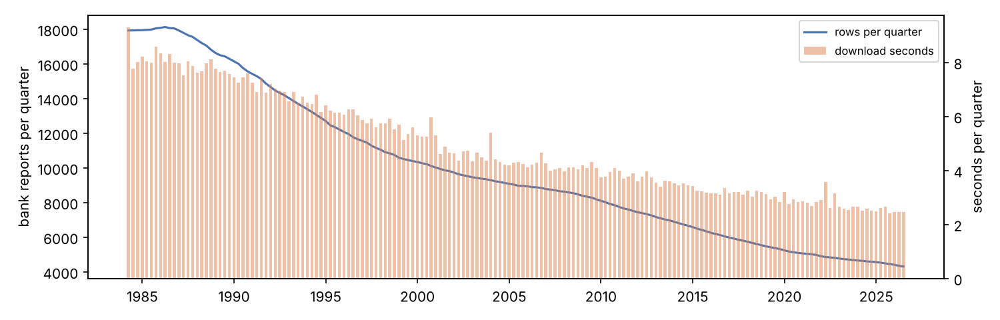
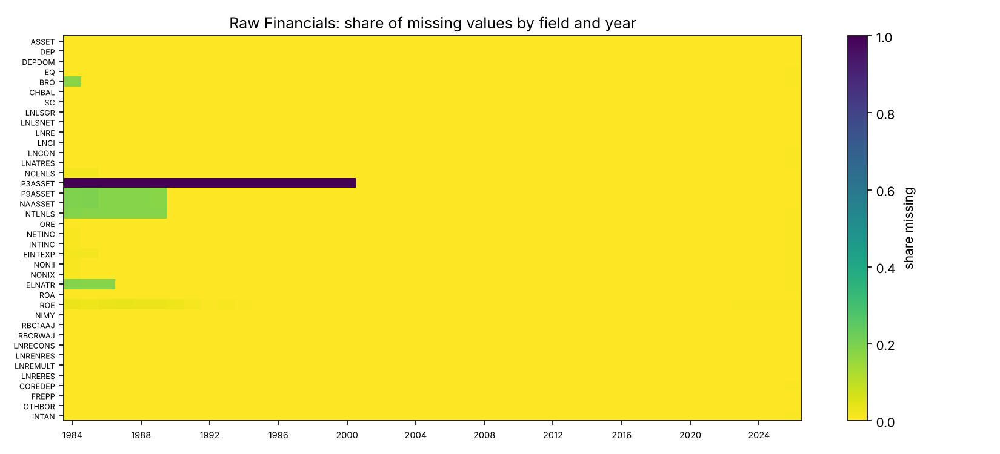
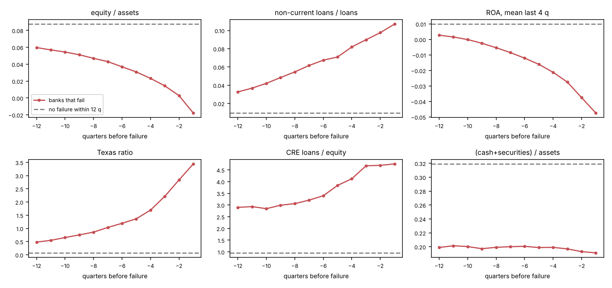
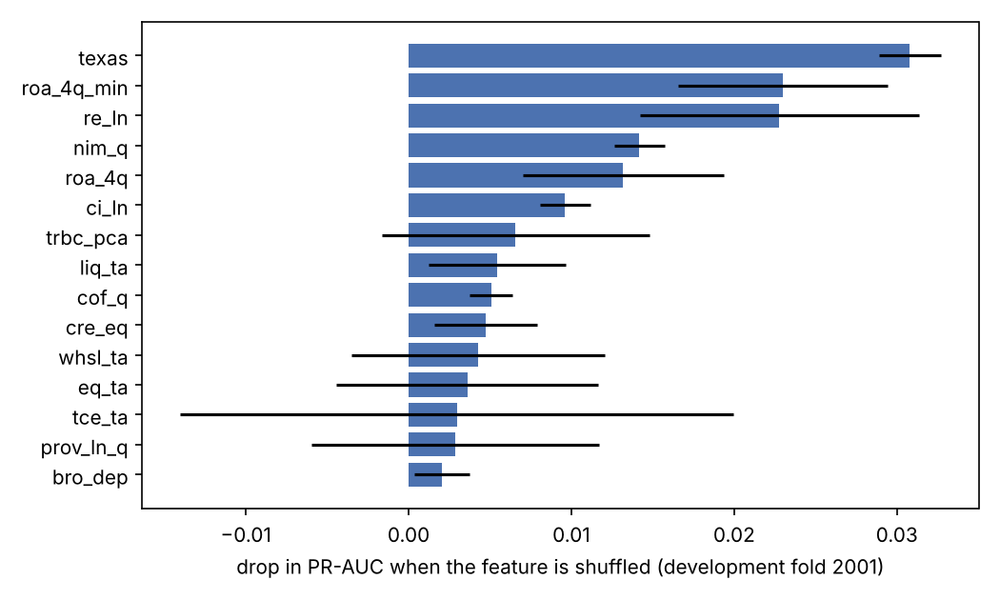
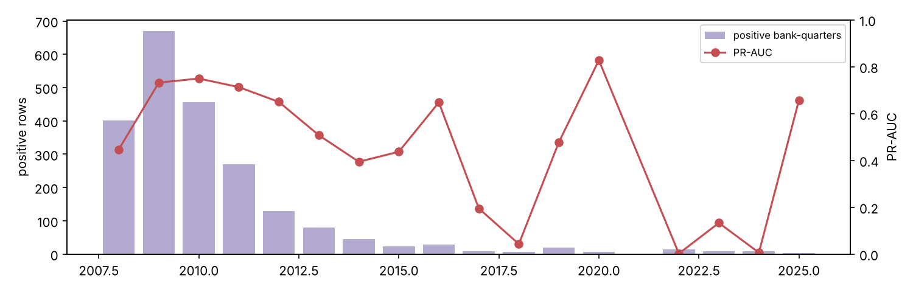
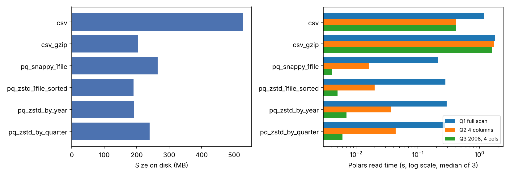
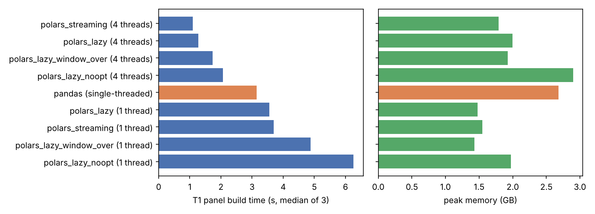

| | |
|----------------------|------------------------------------------------------------------------------|
| **Student** | Nguyễn Phan Anh — Student ID: 11230928 |
| **GitHub repository (public)** | https://github.com/PhanAnhBFT65B-sys/Nguyen-Phan-Anh-BFT65B-Final-Exam-Big-Data |
| **Download method** | FDIC BankFind public API (`api.fdic.gov/banks`), script `code/s01_download.py` (adapted from the course starter); resumable, verified against the API's own row totals |
| **Download date** | 23 November 2026 (API index `risview_20261116221646`) |
| **Row counts** | Financials 1,682,738 bank-quarters (170 quarters, 1984Q1–2026Q2, 24,064 banks); Failures 4,117; Institutions 27,838; clean panel 1,681,643 |
| **Development period** | 1984Q1–2006Q4: 1,193,914 bank-quarters, **2,658 failing banks** (10,251 positive bank-quarters) |
| **Gap** | 2007Q1–2007Q4 (4 quarters, discarded) |
| **Test period** | 2008Q1–2025Q2: 435,446 bank-quarters, **558 failing banks** (2,181 positive bank-quarters), evaluated once |

**Abstract.** An early-warning system for bank supervision is only as reliable as the data pipeline underneath it. Using 42 years of public US Call Reports, I build a reproducible pipeline that downloads, stores, audits, cleans and transforms 1.68 million bank-quarters on a laptop, and I measure every design choice. Parquet with zstd compression is 2.8× smaller than CSV and up to 84× faster to query. A single lazy Polars query builds the point-in-time panel 2.5× faster than idiomatic pandas with 25–33% less memory, and PySpark reproduces it row for row. The automated audit finds problems that would silently corrupt a model: year-to-date income items, capital ratios encoded as zero when missing, failed thrifts that kept reporting, and change codes that label failed banks as mergers. On a single, untouched test period (2008–2025, 558 failing banks), a gradient-boosting model reaches PR-AUC 0.573 (95% CI 0.534–0.608) against 0.527 for a three-ratio baseline. A cost-based alarm that flags 2% of bank-quarters catches 94% of failing banks at least once before they fail. The model misses the 2023 liquidity-driven failures, which shows what public Call Report data cannot see.

# 1. Introduction

## 1.1 Context and research questions

The supervision department of the State Bank of Vietnam plans an early-warning system that ranks banks by their risk of failure. Before any model can be trusted, the department needs a data pipeline that is **reliable** (complete, verified, free of silent errors), **scalable** (fast on today's data and with a known limit) and **reproducible** (anyone can rerun it and get the same numbers). Vietnamese supervisory data are not public, so the pipeline is built and tested on the US Federal Deposit Insurance Corporation (FDIC) data. These cover more than 40 years and three crisis periods: the savings-and-loan and banking crisis of 1984–1993, the global financial crisis of 2008–2012, and the regional-bank failures of 2023.

The report answers three questions:

* **Q1.** How should four decades of bank reports be stored and processed on a laptop, and when would a Spark cluster be needed? (Sections 3 and 5)
* **Q2.** What quality problems do the raw data contain, and how does the pipeline handle them without look-ahead bias? (Section 4)
* **Q3.** Can the pipeline's output support an honestly validated early-warning model? (Sections 6 and 7)

## 1.2 Pipeline overview and design principles

The pipeline is eleven Python scripts, run in order by `python run_all.py`. Each script reads the output of the previous layer and writes its own layer, as in a classic *bronze / silver / gold* data lake:

| Step | Script | Input → output | Exam part |
|------|--------------------------|--------------------------------------------------------|------------|
| 1 | `s01_download.py` | API → **raw layer** (`data/raw/`, Parquet per quarter + manifests) | 1 |
| 2 | `s02_storage_benchmark.py` | raw → six storage layouts, size and speed measurements | 1 |
| 3 | `s03_data_quality.py` | raw → automated quality report (`outputs/dq_report.md`) | 2 |
| 4 | `s04_build_panel.py` | raw → **clean layer** (`data/clean/panel/YEAR=…`), labels, exit types | 2, 3 |
| 5 | `s05_benchmark.py` | Polars vs pandas, threads, optimiser, scaling | 3 |
| 6 | `s06_spark_demo.py` | PySpark reproduction, row-by-row comparison, plans | 3 |
| 7 | `s07_features.py` | clean → **feature layer** (`data/features/`), leakage test | 4 |
| 8 | `s08_model.py` | features → validation, threshold, frozen choices, single test | 5 |
| 9 | `s09_spark_mllib.py` | Spark MLlib demo on a development fold | 5 |
| 10–11 | `s10_summary.py`, `s11_report_figures.py` | bootstrap, publication-lag check, figures | 5, 6 |

Four principles guide every step. (1) **Measure, don't assert**: each design choice is backed by a number that a script writes to `outputs/tables/`, and the file name is given in brackets in this report. (2) **Never overwrite raw data**: errors are fixed in the clean layer by named rules, so every fix can be traced back to an audit finding. (3) **Time flows one way**: no transformation of a quarter *q* may read anything dated after *q*, except the label. (4) **Decide before looking**: the test period is used once, after all choices are written to disk.

# 2. Data acquisition (Part 1)

## 2.1 Source, scope and field selection

All three tables come from the FDIC BankFind API, which needs no key:

* **Financials** (`/financials`): one row per bank (`CERT`, the FDIC certificate number) and report date (`REPDTE`, a quarter-end). These are the quarterly Call Reports: balance sheet, income statement and regulatory ratios. Amounts are in thousands of USD, ratios in percent.
* **Failures** (`/failures`): every failed or FDIC-assisted bank since 1934, with the failure date, the resolution type and the estimated loss to the deposit insurance fund (`COST`).
* **Institutions** (`/institutions`): one row per bank ever insured, with its state, charter class, whether it is active, and the code of its last structural change (`CHANGEC1`).

The scope is fixed by the course: all banks from 1984Q1 to 2026Q2, plus the complete Failures and Institutions tables. **Which fields to download was my choice.** I keep the 30 Call Report fields of the course starter and add eight more, each with a reason drawn from the bank-failure literature (Cole & White, 2012) and from the crisis that motivates it:

| Group | Fields | Why they matter for failure risk |
|--------------------|----------------------------------|----------------------------------------------|
| Size, balance sheet | `ASSET`, `DEP`, `DEPDOM`, `EQ`, `CHBAL`, `SC` | Scale, funding base, equity cushion, liquid assets |
| Loan book | `LNLSGR`, `LNLSNET`, `LNRE`, `LNCI`, `LNCON`, `LNATRES` | Loan exposure by type and the reserve for losses |
| **Real-estate breakdown (added)** | `LNRECONS`, `LNRENRES`, `LNREMULT`, `LNRERES` | Construction and commercial real estate drove most 2008–2012 failures |
| Asset quality | `NCLNLS`, `P3ASSET`, `P9ASSET`, `NAASSET`, `NTLNLS`, `ORE` | Past-due and non-accrual loans, charge-offs and foreclosed property: the classic leading indicators |
| Earnings | `NETINC`, `INTINC`, `EINTEXP`, `NONII`, `NONIX`, `ELNATR`, `ROA`, `ROE`, `NIMY` | Losses erode capital; provisions show the bank's own view of credit risk |
| Capital | `RBC1AAJ`, `RBCRWAJ` | The Prompt Corrective Action ratios that trigger supervisory action |
| **Funding (added)** | `BRO`, `COREDEP`, `FREPP`, `OTHBOR` | Brokered and wholesale funding run first in a crisis; core deposits are sticky |
| **Intangibles (added)** | `INTAN` | Needed for *tangible* equity, which absorbs losses |

Every code was checked in the API field dictionary (`risview_properties.yaml`). The selected fields cover all six CAMELS dimensions that supervisors rate: Capital, Asset quality, Management (proxied by efficiency), Earnings, Liquidity and Sensitivity (proxied by funding mix).

## 2.2 A reproducible, resumable download

`s01_download.py` is adapted from the course starter; the module docstring lists every change. It works in four steps:

1. **Pagination.** The API returns at most 10,000 rows per call, so each quarter is requested with `filters=REPDTE:YYYYMMDD` and fetched page by page with `limit` and `offset` until the API's `meta.total` is reached.
2. **Retry with exponential back-off.** A failed call (HTTP error or timeout) is retried after 2, 4, 8, … seconds, up to six times. A short pause between calls keeps the load on the public API polite.
3. **Typed write per quarter.** Each quarter is converted to an Arrow table with an **explicit schema** (`CERT` int32, `REPDTE` and `STNAME` strings, all 38 numeric fields float64) and written immediately to `raw/financials/REPDTE=YYYYMMDD/part-0.parquet`. The explicit schema matters: without it, a quarter in which a field happens to be all-integer would be inferred as int64 and the next quarter as float64, and the files would no longer stack.
4. **Manifest.** After each quarter, a JSON manifest records the row count, the API total, a completeness flag, the time taken, the API index name (which identifies the data vintage) and a UTC timestamp. On a rerun, any quarter whose file exists **and** is flagged complete is skipped. An interrupted download therefore resumes where it stopped, and an incomplete quarter is downloaded again.

The full download took **830 s of API time** (median 4.3 s per quarter, 14 minutes in total). Figure 1 shows the number of reporting banks per quarter. It falls from 18,133 in the mid-1980s to 4,313 in 2026Q2, because of consolidation and failures. The download time per quarter follows the number of rows, so the download is limited by the API, not by the local machine.

{width=100%}

## 2.3 Completeness verification

A download that "finished without errors" is not the same as a complete download. The verification step [`p1_completeness.json`] checks three independent conditions:

| Check | Result |
|-----------------------------------------------------------------|-----------------------------------|
| Rows per quarter equal the API's `meta.total`, for all 170 quarters | 170 / 170 complete |
| Duplicate (`CERT`, `REPDTE`) keys in the stacked panel | 0 |
| Grand total vs a separate API count for `REPDTE:[19840331 TO 20260630]` | 1,682,738 = 1,682,738 |
| Failures and Institutions rows vs API totals | 4,117 = 4,117; 27,838 = 27,838 |
| Distinct banks in Financials | 24,064 |

The verification was repeated in a fresh clone of the repository, which downloaded everything again from scratch. It gave identical row counts.

# 3. Storage layout (Part 1)

## 3.1 Design choices

Storing data well means choosing four things: **format**, **schema**, **partitioning** and **compression**.

* **Format: Parquet.** A columnar format: each column is stored contiguously, in *row groups* of many rows, with min/max statistics per column and row group in the file footer. A reader can therefore skip columns it does not need (projection) and row groups whose statistics exclude the filter (predicate pruning).
* **Schema: explicit and typed.** Types are written once in the file footer, so they cannot drift between files or be re-guessed on every read.
* **Partitioning.** The raw layer uses one folder per quarter (`REPDTE=…`), which makes the download resumable and append-only: a new quarter is one new file, and nothing is rewritten. The clean layer uses one folder per year (`YEAR=…`, 43 files of about 40,000 rows), sorted by date and bank.
* **Compression: zstd.** A modern codec with a better ratio than snappy and fast decompression.

## 3.2 Measurements

`s02_storage_benchmark.py` writes the same 1.68 M × 41 table in six layouts. It then times three typical queries with Polars, and two with pandas, as the median of three warm runs [`p1_storage_benchmark.csv`, Figure F1 in Appendix F]:

* **Q1 full scan**: all columns, as when the panel is rebuilt.
* **Q2 projection**: 4 columns (`CERT`, `REPDTE`, `ASSET`, `EQ`), as in a quick capital chart.
* **Q3 projection + filter**: 4 columns for the year 2008, as when studying one crisis year.

| Layout | Size (MB) | Files | Write (s) | Q1 full (s) | Q2 4 cols (s) | Q3 2008 (s) | pandas Q1 (s) |
|---------------------------|---------:|------:|--------:|---------:|-----------:|-----------:|------------:|
| CSV | 527.4 | 1 | 45.6 | 1.179 | 0.421 | 0.420 | 0.867 |
| CSV gzip | 203.7 | 1 | 252.1 | 1.777 | 1.714 | 1.590 | 5.678 |
| Parquet snappy, 1 file | 264.7 | 1 | 0.6 | 0.209 | 0.016 | 0.004 | 0.331 |
| **Parquet zstd, 1 file, sorted** | **190.1** | 1 | 0.9 | 0.281 | 0.020 | 0.005 | 0.381 |
| Parquet zstd, partitioned by year | 192.0 | 43 | 0.9 | 0.294 | 0.037 | 0.007 | – |
| Parquet zstd, one file per quarter | 239.3 | 170 | – | 0.278 | 0.044 | 0.006 | – |


## 3.3 Why Parquet beats CSV, from the numbers

1. **Size.** Columnar storage plus zstd makes the data 2.8× smaller than CSV (190 vs 527 MB). Columns compress well because similar values sit next to each other: `REPDTE` repeats the same date about 10,000 times per quarter, and `STNAME` holds only about 50 distinct states. gzip-CSV is about as small, but it is 1.5× (Polars) to 6.5× (pandas) *slower* to read than plain CSV, and 5.5× slower to write than CSV (280× slower than Parquet), because the whole file is one compressed stream that must be decoded in order.
2. **Projection.** Reading 4 of 41 columns takes 0.020 s from Parquet against 0.421 s from CSV (21×). A CSV reader must scan every byte of every line to find the commas, even for columns it then throws away.
3. **Predicate pruning.** The sorted file has 17 row groups, and their min/max statistics show that only one of them contains 2008. The 2008 query therefore reads about 6% of the file and is 84× faster than CSV. With year partitioning, the same pruning happens at the folder level, before any file is opened [`p1_storage_extra.json`].
4. **Types.** CSV loses the schema. On re-reading the CSV, `REPDTE` became an integer, `CERT` became int64, and **`P3ASSET` became a string**. That field is empty for every row before 2001, so type inference over the first 50,000 rows saw only blanks. A pipeline built on that CSV would either crash or silently treat a numeric risk indicator as text.

## 3.4 Choosing among the Parquet layouts

Snappy decodes slightly faster than zstd, but the file is 39% larger. Since the full panel decodes in under 0.3 s with either codec, I chose the smaller one. Partitioning by year costs nothing measurable in size or full-scan time, and it brings two benefits: a new quarter only rewrites the current year's file, and year filters prune whole folders. The one-file-per-quarter raw layer is 26% larger, because each of the 170 small files repeats its own footer and dictionaries (the *small-files problem*). That is acceptable for an append-only landing zone, and it is the reason the clean layer is consolidated by year. In memory, the panel occupies 526 MB in Polars and 572 MB in pandas, about a third of a laptop's RAM. That is a first hint that no cluster is needed (Section 5.5).

# 4. Data quality and the point-in-time panel (Part 2)

## 4.1 The automated audit

`s03_data_quality.py` runs 30 named checks, plus a missing-value profile for every field and every year. It writes a human-readable report [`outputs/dq_report.md`], a machine-readable check table [`p2_dq_checks.csv`] and a missingness heat-map (Figure 2). The checks are organised in five families:

* **Keys and completeness**: duplicate or null keys, quarters with gaps.
* **Validity ranges**: values that cannot be negative, equity larger than assets, extreme ratios.
* **Accounting identities**: sub-totals larger than totals, net loans vs gross loans minus reserves.
* **Semantics over time**: year-to-date accumulation, structural missingness, values encoded as zero.
* **Cross-table consistency**: failures without a certificate, failed banks that keep reporting, change codes vs the failure list.

Each check has an id, and every fix in `s04_build_panel.py` cites the same id. The audit therefore *describes* the problems, the panel script *fixes* them, and the trail between the two is explicit. Because the audit runs on every execution, a new quarter with a new problem would show up immediately.

{width=95%}

## 4.2 Findings and how each one is handled

The most consequential findings are below; the full table is in Appendix A.

| Id | Problem found | Extent | Handling (and why) |
|---|---|---|---|
| F14 | Income items (`NETINC`, `INTINC`, `ELNATR`, …) are **year-to-date** | all flow fields | De-cumulated to quarterly flows (Section 4.3) |
| F14b | YTD interest income *falls* within a year (restatements, mergers) | 2,235 bank-quarters (0.18%) | Negative quarterly interest income set to missing |
| F16–F18 | Risk-based capital ratios **encoded as 0 when not applicable**: `RBCRWAJ` = 0 for 100% of reports before 1990 and for 37% of reports since 2020 (community-bank leverage-ratio filers); `RBC1AAJ` = 0 for 18% of reports before 1990 | 419,535 + 45,423 rows | 0 → missing. Otherwise a model reads "0% capital" as the strongest possible failure signal. Missingness after 2020 is informative, so the imputer keeps a missing-indicator |
| F19 | `P3ASSET` (30–89 days past due) not collected 1984–2000 | 972,047 rows | Kept; imputed inside the model pipeline with an indicator. A column that is empty in a training fold is dropped *in that fold* |
| X07 | **230 thrifts kept filing after a FAILURE date** (RTC conservatorships of 1989–90) | 7.1% of linked failures | Rows dated on or after the bank's first closure are removed: the failure is already known, so these rows are not a prediction problem |
| X07b | 125 banks kept filing after an *assistance* transaction | 3.8% | Kept (open-bank assistance; the bank goes on operating). The label refers to the **next** event |
| I-code | The Institutions change code calls failed banks "mergers": 2,393 failed banks have `CHANGEC1` = 211 (absorbed in a purchase-and-assumption), and every failed bank carries a 2xx "merger" code | 74% of exited failed banks | Failure vs other exit is decided from the **Failures table**, never from the change code |
| X01, X03 | Failures with no `CERT` (488) or before 1984 (842) | 32% of failure rows | Excluded: they cannot be linked to the panel |
| X06 | Failed `CERT` never present in Financials | 22 of 3,275 | Coverage limit, reported |
| F05 | Negative equity | 15,647 rows | **Kept**: a genuine insolvency signal, not an error |
| F07, F06 | Negative stocks (e.g. 645 negative `ORE`), `EQ` > `ASSET` (1 row) | < 0.05% | Set to missing |
| F10 | Real-estate loans > total loans | 36,126 rows (2.1%) | Ratio capped at 1 (definitional mismatch between the two items) |
| F12–F13 | \|ROA\| > 50%, \|ROE\| > 500% (tiny or new banks) | 0.06–0.09% | ROA recomputed from flows; ROE not used; ratios winsorised inside the training pipeline |
| P01 | The API returns the **latest revised** figures, not the first-published vintage | all | Documented limitation (Section 8.4) |

Two principles decide *how* each problem is handled. First, an apparent anomaly is kept when it carries economic meaning: negative equity is exactly what a failing bank looks like, so deleting it would delete the signal. Second, no fix may borrow information from the future. A missing value is never filled with the bank's next report; it stays missing and is imputed later, inside the training pipeline, from training data only.

## 4.3 Year-to-date flows

Call Report income items accumulate from January. The evidence is unambiguous [`p2_ytd_evidence.csv`]:

| Report month | March | June | September | December |
|---|---:|---:|---:|---:|
| Median `INTINC` (USD k) | 1,401 | 2,818 | 4,203 | 5,621 |
| Ratio to March | 1.00 | 2.01 | 3.00 | 4.01 |

Used raw, a bank would look four times as profitable in December as in March, and a December loss would be mixed with the first three quarters' profits. The pipeline therefore computes `X_Q` (quarterly flow) as: `X_Q = X` in the first quarter, and `X_Q = X − X(previous quarter)` in later quarters, **only** if the previous quarter is the immediately preceding quarter of the same year. If a bank skipped a quarter (33 reporting gaps in the data), the flow is set to missing rather than computed against the wrong quarter. After de-cumulation, 0.6% of `NETINC_Q` values are missing, mostly first reports of new banks [`p2_panel_stats.json`].

## 4.4 Exits: failure versus other exits

A bank leaves the panel either because it fails or because it merges, changes charter or closes voluntarily. Treating these exits correctly matters in both directions:

* If exited banks are **dropped**, the sample keeps only survivors (*survivorship bias*), and almost all failures disappear with them.
* If every exit is treated as a failure, the 16,476 mergers become false positives and the model learns that small, growing banks "fail".

The pipeline classifies each bank by its last report [`p2_panel_stats.json`]:

| Exit type | Banks | Rule |
|------------------------|---------:|------------------------------------------------------------------|
| Still active in 2026Q2 | 4,313 | Last report = 2026Q2 |
| **Failure** | **3,080** | A record in the Failures table within 8 quarters after the last report |
| Merger / absorption | 16,476 | Not in the failure list, change code 2xx |
| Other exit | 195 | Neither of the above |

For failures, the gap between the last Call Report and the failure date is one quarter in 2,752 cases, two quarters in 320 cases, and three quarters in 1 case [`p2_fail_gap.csv`]. Every failure is therefore reachable by the four-quarter label window. Merged banks keep all their rows, labelled 0 ("mergers are not failures"). Exited banks are **never** removed.

## 4.5 Label and point-in-time correctness

The label is

*y(i,q)* = 1 if bank *i* has a failure event in the half-open window (REPDTE, end of the fourth following quarter].

It is computed with a hash join on `CERT` between the panel and the failure list, which keeps for each report the **first failure strictly after** its date, then compares that date with the end of the window. The window is half-open on the left: a failure on the report date itself belongs to the past. Assisted resolutions in the FDIC failure list count as failure events. They are 12.6% of in-scope events, mostly in 1984–1992, and in each case the FDIC took a loss-sharing or resolution decision. Only quarters up to 2025Q2 have complete labels (`label_complete`). The clean panel has **1,664,114 complete-label rows, 12,485 of them positive (0.75%), from 3,216 distinct failing banks**.

A worked example from the unit tests shows the rule: a bank that reports every quarter of 2007–2008 and fails on 16 January 2009 gets y = 0 for 2007Q4 (window ends 31 December 2008, before the failure) and y = 1 for 2008Q1 to 2008Q4.

Point-in-time correctness rests on three rules. (i) Every transformation of a row uses that row and *earlier* rows of the same bank only; the previous reported quarter is identified by quarter index, so a reporting gap gives a missing lag instead of a wrong one. (ii) The future enters only through the label. (iii) A unit test (`tests/test_pipeline.py`) pins the de-cumulation, the gap rule and the exact label window on a hand-made mini-panel, so a later code change cannot silently break them.

# 5. Scalable processing (Part 3)

## 5.1 How the Polars engine executes the pipeline

The whole panel (filters, type casts, de-duplication, YTD de-cumulation, the closure filter and the label join) is **one lazy query**. With the lazy API, Polars does not execute each line as it is written. It first builds a *logical plan* (a tree of operations), rewrites it with an optimiser, and only then executes it on all CPU cores, with columnar Apache Arrow memory and vectorised kernels written in Rust. The optimised plan [`p3_polars_plan_panel.txt`, excerpt in Appendix D] shows three optimisations at work:

* **Predicate pushdown.** `ASSET > 0` and the not-null filters move *into* the Parquet scan (the `SELECTION:` line under `Parquet SCAN`), so rejected rows are never materialised in memory.
* **Projection pushdown.** Only the columns the query uses are read. Here all 41 are needed, but in the Spark comparison the same query selects 5 output columns and finishes in 0.44 s instead of 1.3 s, because unused flows are never de-cumulated.
* **Common sub-expression and sub-plan elimination.** Expressions used several times (`CERT == CERT.shift(1)`, the year of `REPDTE`) are computed once and reused (the `__POLARS_CSER_…` columns), and the panel that feeds both sides of the label join is computed once (`CACHE`).

Turning the optimiser off makes the same query 1.6× slower and increases its peak memory by 45% (Section 5.3).

## 5.2 An engine-aware rewrite

My first version followed the textbook pattern: `shift().over("CERT")` for every lag, and a global sort plus `join_asof` for the label. Reading the plan showed why it was slower than necessary. `over()` is a hash group-by followed by a scatter back to the original rows, repeated for each of the 9 lag expressions. The rewrite uses three facts about the data:

1. Once the data are sorted by (`CERT`, quarter), the previous row *is* the previous report whenever `CERT == CERT.shift(1)`. A plain shift is a memory offset, not a group-by.
2. The failure list is tiny (3,253 linked events), so a hash join on `CERT` followed by a small group-by replaces a global sort of 1.7 M wide rows.
3. After the sort, a duplicate key is simply a row equal to the previous one, so de-duplication costs a comparison instead of a hash `unique` (measured 0.48 s → about 0.01 s).

```python
same_bank = pl.col("CERT") == pl.col("CERT").shift(1)
prev_q    = pl.when(same_bank).then(pl.col("Q").shift(1))
consec    = (pl.col("Q") - prev_q == 1) & (pl.col("Q") // 4 == prev_q // 4)
NETINC_Q  = pl.when(is_first_quarter).then(pl.col("NETINC")) \
              .when(consec).then(pl.col("NETINC") - pl.col("NETINC").shift(1))
```

The rewrite cuts the run time by 26% (1.28 s vs 1.74 s) with identical output. It is kept in the code as `variant="window_over"` so the benchmark can compare the two.

## 5.3 Fair benchmark against pandas

A benchmark is only useful if it is fair. The rules in `s05_benchmark.py` are:

* the **same input file** (the sorted zstd Parquet) and the **same logical output** for every engine;
* **idiomatic, vectorised pandas**: no Python lambdas in hot paths, `merge_asof` for the label, grouped `rolling` for moving sums;
* each run in a **fresh Python process**, so memory is measured honestly (peak resident set size) and nothing is cached in the interpreter;
* the **median of three runs**; task time measured inside the process, excluding imports;
* Polars timed with all 4 cores **and** with one thread (`POLARS_MAX_THREADS=1`), with and without the optimiser, and in streaming mode;
* **equality checks**: row count, number of positives, the sum of quarterly net income and the count of missing values must be identical across engines [`p3_benchmark_equality.json`]. They are.

Three tasks are measured: **T1** the panel build of Section 5.1; **T2** dynamic features (year-on-year changes by self-join on quarter − 4, and a 4-quarter rolling sum); **T3** per-quarter cross-sectional aggregates (counts, sums, medians, quantiles).

| Task (1.68 M rows) | pandas | Polars lazy | Polars streaming | Polars, 1 thread | Polars, optimiser off |
|---|---:|---:|---:|---:|---:|
| T1 panel build: time (s) | 3.15 | **1.28** | **1.09** | 3.55 | 2.06 |
| T1 peak memory (GB) | 2.74 | 2.04 | **1.83** | 1.51 | 2.97 |
| T2 dynamic features (s) | 1.29 | **0.35** | – | – | – |
| T3 per-quarter aggregates (s) | 0.22 | **0.08** | – | – | – |


**Interpretation.** Polars is 2.5–2.9× faster than pandas on the panel build, 3.7× on the dynamic features and 2.7× on the aggregates, and it uses 25–33% less memory. The configuration runs decompose the gain:

* **Parallelism is the main source of speed.** On one core Polars is about as fast as pandas (3.55 s vs 3.15 s), so on this workload most of the speed-up comes from running the same plan on four cores. pandas runs these operations on a single core.
* **The engine mainly saves memory.** Arrow columnar buffers and the absence of Python objects keep peak memory 25% (4 threads) to 45% (1 thread) below pandas.
* **The optimiser is worth 1.6×** (2.06 → 1.28 s), mostly by pushing filters into the scan and by computing shared sub-plans once.
* **Streaming** processes the data in batches. It is slightly faster here and uses the least memory with all cores, which matters for the scaling test.

## 5.4 PySpark reproduction

`s06_spark_demo.py` re-implements T1 and T3 with the Spark DataFrame API in local mode (Spark 4.3, 4 cores). I set 8 shuffle partitions instead of the default 200, which would create 200 tiny tasks for a 1.7 M-row table. The YTD lag uses `Window.partitionBy("CERT").orderBy("Q")`, and the label uses a broadcast range join (`FAIL_DATE > REPDTE AND FAIL_DATE <= last_day(add_months(REPDTE, 12))`).

**Results match exactly** [`p3_spark_vs_polars.json`]:

| Check | Polars | Spark |
|------------------------------------------------------------|-------------------:|-------------------:|
| Rows | 1,681,643 | 1,681,643 |
| Rows present in only one engine | 0 | 0 |
| Positive labels | 12,496 | 12,496 |
| Label mismatches (row by row) | 0 | 0 |
| Max absolute difference in quarterly net income | 0 | 0 |
| Mismatched missing patterns | 0 | 0 |

**Reading the physical plans** [`p3_spark_plan_*.txt`]:

* `FileScan parquet … PushedFilters: [IsNotNull(CERT), …, GreaterThan(ASSET,0.0)]` with a three-column `ReadSchema` in the label branch: the same predicate and projection pushdown as in Polars.
* `BroadcastHashJoin … BuildRight`: the small failure table is copied to every executor, so the 1.7 M-row side is **not shuffled** for the label join.
* `Exchange hashpartitioning(CERT, 8)` before each `Window`: a shuffle, the expensive step in a cluster, where rows travel over the network. The plan stacks **eight `Window` operators**, one per lagged column, because each `withColumn` adds its own window expression.
* The final join of labels back onto the panel is a `SortMergeJoin` on (`CERT`, `REPDTE`), with an exchange and a sort on **both** sides. The plan also re-derives the cleaning lineage inside the label branch. Polars avoided both, with the `CACHE` node and a left join that keeps order.
* The aggregate plan runs `partial_…` aggregations, an `Exchange`, then `merge_…` aggregations, twice, because `countDistinct` needs an extra grouping level. `AdaptiveSparkPlan isFinalPlan=true` and `AQEShuffleRead coalesced` show adaptive query execution merging small shuffle partitions at run time.

**Cost of the abstraction.** The Spark job took 50 s for T1 and 48 s for T3, against about 1.3 s and 0.08 s in Polars, roughly 40× slower. At this size Spark's fixed costs dominate: JVM start-up, planning, task scheduling, serialisation between JVM and Python, and shuffle files written to local disk. Spark is built to survive data that do not fit on one machine, not to be fast on data that do.

## 5.5 When is a cluster justified?

To find the limit of one machine, I replicated the panel 2×, 4× and 8× (up to 13.5 M rows, each copy with shifted certificate numbers) and measured time and peak memory in fresh processes [`p3_scaling.csv`, Figure 3]:

| Input rows | pandas time / memory | Polars lazy time / memory | Polars streaming time / memory |
|-------------------|--------------------------:|--------------------------:|--------------------------:|
| 1.7 M (×1) | 3.4 s / 2.7 GB | 1.2 s / 2.0 GB | 1.3 s / 1.7 GB |
| 3.4 M (×2) | 6.6 s / 5.3 GB | 2.4 s / 3.2 GB | 2.3 s / 2.5 GB |
| 6.7 M (×4) | 16.1 s / 10.4 GB | 5.1 s / 5.5 GB | 4.9 s / 4.5 GB |
| 13.5 M (×8) | skipped (would exceed RAM) | 12.0 s / 10.5 GB | 9.4 s / 7.3 GB |

{width=90%}

Time and memory grow **linearly**: about 1.55 GB per million rows for pandas, against 0.55 GB per million rows for streaming Polars. On a 16 GB laptop with about 12 GB usable, the single-machine limit for this workload is about 7–8 M rows for pandas, about 15 M rows for in-memory Polars and about 22 M rows for streaming Polars. Beyond that, Polars streaming can still process larger-than-RAM data by writing results directly to disk (`sink_parquet`).

The full FDIC panel (1.7 M rows, 190 MB) is **about 10× below** that limit, and it grows by only about 17,000 rows a year. **A cluster is therefore not justified for this problem.** It would be justified when:

1. the data are one to two orders of magnitude larger: loan-level credit-registry data, daily payment or transaction data, branch-level deposits (hundreds of millions of rows, tens of GB);
2. the data no longer fit on one machine's disk, or must be shared by many analysts with uptime guarantees and access control;
3. the work is embarrassingly parallel and slow, such as thousands of model refits for stress tests or a large hyper-parameter search.

# 6. Feature pipeline (Part 4)

## 6.1 Feature design

I built 36 features [`s07_features.py`; full dictionary in Appendix B], grouped by the CAMELS framework that supervisors use, plus dynamics and system context:

* **Capital (4)**: equity/assets, tangible equity/tangible assets, PCA leverage ratio, total risk-based capital ratio. Capital is the buffer that absorbs losses; a bank fails when it is exhausted.
* **Asset quality (8)**: non-current loans/loans, non-accrual, 30–89 and 90+ days past due, other real estate owned/assets, loan-loss reserve/loans, and the **Texas ratio** (non-current loans + OREO) / (tangible equity + reserves), which compares problem assets with the resources to absorb them.
* **Earnings (6)**: annualised quarterly ROA, net interest margin, cost of funds, provisions and net charge-offs over loans, and the efficiency ratio (a proxy for management quality).
* **Liquidity and funding (5)**: (cash + securities)/assets, brokered/total deposits, wholesale funding/assets, core deposits/assets, loans/deposits.
* **Concentration (5)**: real-estate, construction, C&I and consumer loan shares, and CRE/equity (US supervisory guidance draws attention to banks above 300%).
* **Size (1)**: log assets.
* **Dynamics (6)**: year-on-year asset and loan growth (rapid growth often precedes losses), the change in the equity ratio and in the non-current loan ratio, and the mean and minimum quarterly ROA over the last four quarters.
* **System context (2)**: the share of banks with negative ROA and the median non-current ratio *in the same quarter*, which tell the model whether the whole system is under stress.

## 6.2 Evidence that the features are informative

Two pieces of evidence, both computed on the **development period only** so the test period stays untouched, show that these features separate failing from surviving banks.

**Event study** [`p4_event_study.csv`, Figure 4]: medians of key ratios *k* quarters before failure, against banks that do not fail within 12 quarters.

| Quarters before failure | 12 | 8 | 4 | 1 | No failure |
|-----------------------------------|-----------:|-----------:|-----------:|-----------:|----------------:|
| Equity / assets | 6.0% | 4.7% | 2.3% | −1.8% | 8.8% |
| Non-current loans / loans | 3.3% | 5.5% | 8.2% | 10.7% | 1.0% |
| ROA, mean of last 4 quarters | 0.28% | −0.53% | −2.12% | −4.74% | 0.99% |
| Texas ratio | 0.48 | 0.86 | 1.70 | 3.44 | 0.08 |
| CRE loans / equity | 2.90 | 3.06 | 4.12 | 4.76 | 0.96 |

{width=100%}

Deterioration is visible **three years ahead**: twelve quarters before failure, the median failing bank already has a Texas ratio six times, and a non-current loan ratio three times, that of a healthy bank. The ratios then worsen steadily. Capital is the *last* to break, which is why a model on capital alone warns late. Liquidity (cash + securities) is lower for failing banks at every horizon (19–20% vs 32%) but does not trend. This supports including it as a level feature, not as a trigger.

**Permutation importance** on the last development fold (Figure 6 in Section 7) ranks the Texas ratio, the worst quarterly ROA of the last year, the real-estate loan share and the net interest margin highest. These are the asset-quality, earnings and concentration channels of the event study.

## 6.3 Leak-free by construction

* **Backward-only joins.** Every feature uses the bank's row at *q* and, for dynamics, explicit **backward** self-joins on (`CERT`, *q*−1 … *q*−4). A missing earlier quarter gives a missing feature. No negative shift exists anywhere in the code.
* **Safe ratios.** A ratio with a non-positive denominator becomes missing; nothing is filled from a later quarter.
* **Same-quarter context.** The system-context features use other banks' reports for the **same** quarter, which are published together.
* **Fitted steps live in a training-only pipeline.** Nothing that must be *fitted* (winsorising limits, imputation medians, scaling constants) is computed on the full table. All of it lives in a scikit-learn `Pipeline` that is refitted inside each training fold:

`DropEmpty → Winsorizer(0.5%, 99.5%) → SimpleImputer(median, add_indicator=True) → StandardScaler → model`

`DropEmpty` removes columns that are entirely missing *in the training fold* (for example 30–89 days past due before 2001). The `Winsorizer` learns its clipping limits from the training fold and applies them unchanged to validation and test data. The imputer's missing-indicators keep the information that a value was absent (for example, a community-bank leverage-ratio filer).

## 6.4 Proving the absence of leakage

A design that *should* be leak-free is not proof. `assert_point_in_time` provides a direct test: it recomputes all 36 features from a panel **truncated** at a cut-off date and compares the features at that date with those computed from the full panel. If any feature used a row dated after the cut-off, the two would differ. The test passes, with identical values for every feature and every bank, at three cut-offs [`p4_feature_checks.json`]:

| Cut-off | Banks compared | Features | Result |
|---|---:|---:|---|
| 1990Q4 | 15,418 | 36 | PASS |
| 2008Q4 | 8,395 | 36 | PASS |
| 2023Q1 | 4,740 | 36 | PASS |

The feature table holds 1,681,643 rows. The label and the failure date are carried alongside for evaluation, but they are never inputs to any feature.

# 7. Modelling and validation (Part 5)

## 7.1 Split

The modelling sample uses quarters up to 2025Q2. **Development: 1984Q1–2006Q4. Gap: 2007Q1–Q4 (discarded). Test: 2008Q1–2025Q2** (Figure 5).

{width=95%}

The gap guarantees that no development label window, which reaches up to 2007Q4, overlaps the test period; the code asserts this. I chose this split *before* looking at any test result, for three reasons. (i) It mimics real deployment: a system built with data up to 2006 would have faced the global financial crisis. (ii) The test set is large: 558 failing banks, ten times the required 50, so its metrics are precise. (iii) The test period covers a crisis (2008–12), a quiet decade and the 2023 regional-bank episode. The cost is a regime shift: development failures are mostly 1980s credit and thrift failures. That makes the test harder, and therefore more honest.

| | Development | Test |
|---|---:|---:|
| Bank-quarters | 1,193,914 | 435,446 |
| Positive bank-quarters | 10,251 (0.86%) | 2,181 (0.50%) |
| Failing banks | 2,658 | 558 |

## 7.2 Validation scheme and metrics

Inside the development period I use **rolling-origin (expanding-window) validation with a 4-quarter purge**: train on all quarters up to December of year *t*−2, skip year *t*−1, and validate on year *t*, for *t* ∈ {1988, 1990, 1992, 2001}. The purge matters: a training row from year *t*−1 would have a label window reaching into year *t*, so it would carry information about the validation failures. The four years cover the peak (1988), the tail (1990, 1992) and the quiet period (2001) of the first crisis. **Random K-fold is not used**: it would put quarters of the same crisis, and of the same bank, on both sides of the split and overstate skill (López de Prado, 2018).

Positives are 0.75% of rows, so accuracy is meaningless: predicting "no failure" is 99.25% accurate. The metrics are:

* **PR-AUC** (average precision), the primary metric. It summarises precision across all recall levels and, unlike ROC-AUC, is not inflated by the huge number of easy negatives (Saito & Rehmsmeier, 2015). Its no-skill value equals the positive rate (0.005 in test).
* **ROC-AUC**, reported for comparison with the literature.
* **Brier score**, the mean squared error of the probabilities, which measures calibration.
* **Recall and precision in the top 2%** of bank-quarters, the supervisor's view: "if we can examine 2% of banks, how many future failures are among them?"

## 7.3 Models and development results

* **B0 baseline**: logistic regression on three ratios (equity/assets, non-current loans/loans, 4-quarter ROA), one for each of capital, asset quality and earnings.
* **M1**: L2-regularised logistic regression on all 36 features (C ∈ {0.1, 1}), with balanced class weights.
* **M2**: histogram gradient boosting (scikit-learn), which captures non-linear thresholds and interactions (for example, high CRE concentration is dangerous only when capital is thin) and handles missing values natively. Three configurations of learning rate and tree size.

| Model (development CV) | 1988 | 1990 | 1992 | 2001 | Mean PR-AUC | Mean ROC-AUC | Mean Brier |
|-------------------------------|--------:|--------:|--------:|--------:|----------:|----------:|----------:|
| B0 logistic, 3 ratios | 0.711 | 0.283 | 0.203 | 0.104 | 0.325 | 0.933 | 0.039 |
| M1 logistic, C = 0.1 | 0.737 | 0.367 | 0.283 | 0.103 | 0.372 | 0.955 | 0.035 |
| M1 logistic, C = 1 | **0.739** | 0.369 | 0.284 | 0.103 | 0.374 | 0.955 | 0.035 |
| M2 boosting, lr 0.05, 15 leaves | 0.639 | 0.506 | **0.463** | 0.177 | 0.446 | **0.960** | **0.010** |
| **M2 boosting, lr 0.05, 31 leaves** | 0.641 | **0.529** | 0.460 | **0.211** | **0.460** | 0.956 | 0.011 |
| M2 boosting, lr 0.1, 15 leaves | 0.630 | 0.487 | 0.457 | 0.172 | 0.437 | 0.955 | 0.011 |

Gradient boosting wins on the primary metric: a boosting configuration is best in three of the four folds, and logistic regression only in 1988, the first crisis year, with the least training data. Boosting is also far better calibrated (Brier 0.010 vs 0.035), because the logistic models use balanced class weights that push probabilities upward. Skill falls in 2001 for every model: with only 37 positive rows, failures in a calm year are idiosyncratic. The selected model is **M2 (lr 0.05, 31 leaves)**, the best on mean PR-AUC and on the worst fold.

{width=75%}

## 7.4 Alarm threshold from costs

A probability is not yet a decision. The supervisor needs a threshold above which a bank is flagged. Two errors have different costs:

* **A missed failure** (false negative) costs the deposit insurance fund the resolution loss. **Estimated from the data**: the median `COST` of development-period failures is **USD 8.87 m**, and the median loss rate is 20.2% of assets.
* **A false alarm** (false positive) triggers a targeted examination of a healthy bank. Its cost is not in the FDIC data, so I state it as an **assumption, USD 250 k**, and show below how the threshold moves when it changes.

The threshold minimises the expected cost C_FN·FN + C_FP·FP on the pooled **out-of-fold development predictions** (Elkan, 2001). It is searched on a grid of 400 quantiles of the predicted probabilities. Choosing it empirically, rather than with the textbook formula C_FP / (C_FP + C_FN), protects against residual miscalibration. The result is a threshold of **0.0072**, which flags 7.0% of development bank-quarters (Figure 7, right).

| Assumed C_FP (USD k) | C_FN / C_FP | Threshold | Flag rate (dev) | Recall (dev) | Precision (dev) |
|---:|---:|---:|---:|---:|---:|
| 50 | 177 | 0.0021 | 11.0% | 0.96 | 0.15 |
| 100 | 89 | 0.0025 | 10.3% | 0.96 | 0.16 |
| **250** | **35** | **0.0072** | **7.0%** | **0.93** | **0.23** |
| 500 | 18 | 0.0168 | 5.1% | 0.89 | 0.30 |
| 1,000 | 9 | 0.0388 | 3.8% | 0.82 | 0.38 |
| 2,500 | 3.5 | 0.0765 | 2.9% | 0.75 | 0.44 |

The table makes the trade-off explicit: a supervisor who values an examination more highly flags fewer banks and accepts missing more failures. Because missed failures are 35 times as costly as false alarms under the base case, the optimal policy tolerates about three false alarms for each failure caught.

The model, features, threshold and costs were written to `p5_frozen_choices.json` (with a SHA-256 hash and a timestamp) **before** the test evaluation ran.

## 7.5 Single evaluation on the test period

| Test 2008Q1–2025Q2 | PR-AUC | ROC-AUC | Brier | Recall top 2% | Precision top 2% |
|---|---:|---:|---:|---:|---:|
| B0 baseline (3 ratios) | 0.527 | 0.974 | 0.0230 | 0.849 | 0.213 |
| **M2 gradient boosting** | **0.573** | **0.980** | **0.0034** | **0.861** | **0.216** |

{width=100%}

**At the frozen threshold** the confusion matrix on the test period is:

| | Predicted alarm | No alarm |
|---|---:|---:|
| **Fails within 4 quarters** | 1,878 (TP) | 303 (FN) |
| **Does not fail** | 6,876 (FP) | 426,389 (TN) |

That is a flag rate of 2.0%, recall 0.86 and precision 0.21. The flag rate is lower than in development (7.0%) because the test period has a lower base rate of failures, and the calibrated model correctly issues fewer alarms. **94% of the 558 failing banks are flagged at least once before they fail.** Under the cost assumptions, the expected cost is USD 4.4 bn, against USD 19.3 bn for raising no alarm at all.

**Uncertainty.** A bank-cluster bootstrap resamples *banks*, not rows, because rows of one bank are correlated over time. With 300 resamples it gives a 95% CI of **0.534–0.608** for PR-AUC and 0.974–0.986 for ROC-AUC [`p5_test_bootstrap.json`]. The gain over the baseline (0.046) is real but moderate: three well-chosen ratios already carry most of the signal, which is consistent with the event study.

**How early?** Recall at the frozen threshold falls with the horizon [`p5_test_recall_by_horizon.csv`]:

| Quarters to failure | 1 | 2 | 3 | 4 |
|---|---:|---:|---:|---:|
| Positive rows | 551 | 554 | 546 | 530 |
| Recall | 0.95 | 0.91 | 0.85 | 0.74 |

Three quarters of failing banks are already flagged a full year ahead, enough time for an on-site examination and corrective action.

**Publication lag.** A Call Report becomes public about 30–60 days after quarter-end. 410 test positives (19%) are failures within 60 days of the report date, on which a supervisor might not have been able to act in time. Removing them gives PR-AUC 0.464 and ROC-AUC 0.978 [`p5_publication_lag_check.json`]. The model's skill is therefore not driven by these "almost-failed" rows.

**Stability over time** [`p5_test_by_year.csv`, Figure 8]. PR-AUC is 0.65–0.75 in 2009–2012, at the height of the crisis wave, and stays informative in most later years. It is close to 0, however, for the 2022–2024 rows that preceded the 2023 failures (Silicon Valley Bank, Signature, First Republic). Those banks were well capitalised and profitable on paper, with few bad loans. They failed through **runs on uninsured deposits and unrealised losses on securities**, which none of the selected Call Report ratios measures. This is the most important finding for the design of a real system: an early-warning model only sees the risks its data describe.

{width=95%}

## 7.6 Spark MLlib demo

`s09_spark_mllib.py` fits a Spark ML `Pipeline` (Imputer → VectorAssembler → StandardScaler → weighted LogisticRegression) on one development fold (train ≤ 1990, validate 1992). It also fits the matching scikit-learn logistic regression on exactly the same rows. The test period is deliberately not used, so it stays single-use. Like `DropEmpty`, the Spark pipeline drops the one feature with no value in that training fold (`pd30_ta`).

| Same fold, same rows | Spark MLlib | scikit-learn |
|---|---:|---:|
| ROC-AUC | 0.974 | 0.977 |
| PR-AUC | 0.194 | 0.284 |
| Fit time | 39 s | 9 s |

The ROC-AUCs agree closely. The PR gap has two causes. The Spark pipeline has no winsorising or missing-indicator step, so extreme ratios of tiny banks distort a linear model. And Spark computes the area under the PR curve by trapezoidal interpolation, while scikit-learn's average precision uses a step-wise sum. The 4× slower fit confirms the conclusion of Section 5: at this data size, Spark adds overhead without benefit [`p5_spark_mllib.json`].

# 8. Conclusions (Part 6)

The three questions of Section 1.1 are answered below. Each answer gives the short answer first, then the evidence from the measurements, then the reasoning a supervisor would need to apply it to another dataset.

## 8.1 Q1 — How should four decades of bank reports be stored and processed on a laptop, and when would a Spark cluster be needed?

**Short answer.** Store the data as typed, zstd-compressed Parquet in two layers, process them with lazy Polars on one machine, and keep Spark for data at least ten times larger than the FDIC panel.

**Storage.** Four decades of quarterly Call Reports are 1.68 M rows × 41 columns. That is "big" for a spreadsheet, which stops at about one million rows, but small for a modern laptop. The decisive question is therefore not *where* to store the data but *how*. The measurements of Section 3 support three choices:

1. *Parquet rather than CSV.* The same table is 190 MB in zstd Parquet against 527 MB in CSV (2.8× smaller). A full read is about 4× faster, a 4-column read is 21× faster, and a 4-column read of one year is 84× faster, because Parquet lets the reader skip columns (projection) and row groups (min/max statistics). Just as important, Parquet keeps the schema. The CSV round trip silently turned `REPDTE` into an integer and `P3ASSET` into a string; a model trained on that file would have been wrong without any error message.
2. *Two layers with different partitioning.* The raw landing zone keeps one file per quarter. This makes the download resumable and append-only, and each file can be checked against the API's own row count (170/170 quarters verified). The clean layer is consolidated into one file per year. This avoids the small-files problem (the per-quarter layout is 26% larger because every file repeats its own footer) while still letting a year filter prune whole folders.
3. *zstd rather than snappy.* zstd gives a file 39% smaller for a decode time that stays under 0.3 s for the whole panel, so the smaller file wins.

**Processing.** The whole clean panel is built by one lazy Polars query in about 1.3 s. Polars is 2.5–3.7× faster than idiomatic pandas on the three tasks and uses 25–33% less memory, with outputs that are identical to the last row. The configuration runs explain *why*: most of the speed comes from running the plan on all cores (on one core Polars is no faster than pandas), the query optimiser is worth another 1.6× (predicate and projection pushdown, shared sub-plans computed once), and the Arrow memory layout keeps peak memory low. The practical lesson is that the engine matters less than writing the query so the engine can optimise it: reading the plan and replacing nine window group-bys with sorted shifts cut the run time by a further 26%.

**When a cluster is needed.** The scaling test answers this with a number instead of an opinion. Time and memory grow linearly with rows; streaming Polars needs about 0.55 GB per million rows, so a 16 GB laptop can process about 20 M rows of this workload. The full FDIC panel is about 10× below that limit and grows by only about 17,000 rows a year, so it will not reach it in any realistic horizon. On this data, PySpark produced exactly the same panel and labels but was about 40× slower, because its fixed costs (JVM start-up, planning, scheduling, serialisation, shuffle files) dominate when the data fit on one machine. A cluster becomes the right tool only when at least one of three conditions holds: (i) the data are one to two orders of magnitude larger, as with loan-level registry data or daily payments; (ii) the data must be shared by many users with uptime guarantees and access control; or (iii) the work is a very large number of independent, slow jobs, such as stress-test simulations. For a national bank-level supervisory panel, none of these holds today.

## 8.2 Q2 — What quality problems do the raw data contain, and how does the pipeline handle them without look-ahead bias?

**Short answer.** The raw data are clean in format but contain six *silent* traps, each of which would bias a model without causing an error. The pipeline detects each one with a named automated check and fixes it with a rule that only uses information available at the report date.

**The problems.** The audit of Section 4 runs 30 checks on every execution. The six that matter most are:

| Trap | What goes wrong if it is ignored | How the pipeline handles it |
|---|---|---|
| Year-to-date income items | A bank looks four times as profitable in December as in March; a December loss is hidden by earlier profits | De-cumulated to quarterly flows, using the previous quarter only if it is the immediately preceding quarter of the same year |
| "Not applicable" encoded as 0 (risk-based capital before 1990, CBLR filers since 2020) | The model reads 0% capital as the strongest failure signal | 0 → missing, with a missing-indicator inside the model pipeline |
| Fields not collected before 1990/2001 | Imputation from the full table would carry later years' distributions into the past | Kept missing; imputed and winsorised inside each training fold only |
| 230 thrifts that kept filing after they failed | Rows after the failure would be "predicted" with hindsight | Rows on or after the first closure date are removed |
| Change codes that call failed banks "mergers" | 74% of failed banks would be labelled as harmless exits | Failure vs other exit is decided only from the Failures table |
| Revised rather than first-published figures | Real-time performance may be slightly overstated | Documented as a limitation; a production system should keep vintages |

**Why the fixes do not create look-ahead bias.** Look-ahead bias appears whenever a value at quarter *q* is computed with information from after *q*. The pipeline closes every channel through which this could happen:

* *Row-level rules use the past only.* De-cumulation uses the previous quarter; lags use the previous reported quarter and give a missing value if a quarter is skipped; a missing value is never filled with the bank's next report.
* *Fitted steps never see the future.* Winsorising limits, imputation medians and scaling constants are learned inside a scikit-learn `Pipeline` that is refitted on each training fold, so validation and test rows are transformed with parameters estimated from earlier data only.
* *The future enters only through the label*, and the label window is half-open: a failure on the report date itself belongs to the past.
* *Anomalies with economic meaning are kept.* Negative equity (15,647 rows) is not an error; it is exactly what a failing bank looks like. Deleting it would have removed the signal the model needs.

**Evidence rather than intention.** A design that *should* be leak-free is not proof, so the pipeline tests it. The truncation test recomputes all 36 features from data cut at 1990Q4, 2008Q4 and 2023Q1 and finds identical values for every bank and feature. The unit tests pin the de-cumulation, the gap rule and the exact label window, so a later code change cannot break them silently. Exited banks are never dropped, which avoids survivorship bias, and mergers keep label 0, which avoids treating 16,476 healthy exits as failures.

## 8.3 Q3 — Can the pipeline's output support an honestly validated early-warning model?

**Short answer.** Yes, within clear limits. The pipeline's output supports a model that is validated honestly, performs well on a long out-of-sample period that includes a crisis, and states openly where it fails.

**What makes the validation honest.** Four safeguards are built in, and each one closes a specific route to over-optimistic results:

1. *Time order.* Development (1984–2006) comes strictly before test (2008Q1–2025Q2), so the model is evaluated as it would have been used: trained on the past, applied to the future.
2. *Purge and gap.* A 4-quarter purge inside the rolling-origin validation, and a 4-quarter gap (2007) before the test period, ensure that no training label window overlaps the evaluation period. Random K-fold was rejected because it would put quarters of the same crisis and the same bank on both sides of the split.
3. *Training-only preprocessing.* Every fitted transformation lives inside the training folds (Section 6.3).
4. *A single, frozen test.* The model, features, cost assumptions and threshold were written to a hashed file before the test ran, and the test was evaluated once.

**What the model achieves.** On 435,446 test bank-quarters with 558 failing banks, the selected gradient-boosting model reaches PR-AUC 0.573 (bank-bootstrap 95% CI 0.534–0.608), against 0.005 for a no-skill model and 0.527 for the three-ratio baseline. At the threshold chosen from development costs only, it flags 2.0% of bank-quarters, catches 86% of positive rows and **94% of failing banks at least once before failure**, and three quarters of failing banks a full year ahead. Removing the failures that happen within 60 days of the report, on which a supervisor could not act, lowers PR-AUC to 0.464 but leaves the conclusion intact.

**How to read these numbers.** Three points keep the result honest rather than flattering. First, the gain over the baseline is real but moderate: three well-chosen ratios (capital, asset quality, earnings) already carry most of the signal, which is consistent with the event study and with Cole & White (2012). The value of the pipeline lies as much in making that baseline *trustworthy* as in the extra accuracy. Second, the precision of about 0.21 means roughly four false alarms for each true one; under the stated costs this is the optimal trade-off, but a supervisor with a higher examination cost would choose a higher threshold (Section 7.4). Third, the model is blind to the 2023 failures. Silicon Valley Bank, Signature and First Republic looked healthy on every selected ratio and failed through runs on uninsured deposits and unrealised securities losses. This is not a defect of the validation but one of its most useful outputs: it shows precisely which data a real early-warning system must add.

**Overall answer.** The pipeline turns 42 years of raw reports into a point-in-time-correct, leak-tested panel, and on that panel a simple, frozen model detects most bank failures early enough to act. Its honest limits (revised data, an assumed false-alarm cost, and risk channels missing from the field set) are documented and measurable, which is exactly what a supervisor needs before relying on such a system.

## 8.4 Limitations

1. **Vintage.** The API serves revised data, not the figures available at the time, so real-time performance may be slightly lower.
2. **False-alarm cost.** It is an assumption; the sensitivity table shows its effect on the threshold.
3. **Label definition.** Assisted resolutions are counted as failures, and failures without a certificate number (pre-1984 or unlinked) are excluded.
4. **Regime shift.** Development failures are dominated by the 1980s, a different regime from the test period; a production system would be retrained as new failures arrive.
5. **Missing risk channels.** Uninsured deposits, securities at market value, interest-rate risk and market data (equity prices, CDS spreads) are not in the field set, and they are exactly what the 2023 failures needed.
6. **Reporting lag.** About a fifth of positives fail within 60 days of their report; the lag check shows that the conclusions hold without them.

## 8.5 What would change for Vietnam

Vietnam has about 50 banks and few formal failures. Recent problem banks were placed under special control (several from 2015) and later restructured through compulsory transfer to stronger banks (2024–2025), rather than closed. Four things would change:

* **The label** must be redefined as *distress*: special control, forced restructuring, breaches of prudential ratios or emergency liquidity support. Closure is too rare to learn from.
* **The sample** is far too small for a pooled machine-learning model of this kind. Expert-weighted CAMELS scores, models transferred from international data, and monthly prudential reports would carry more weight.
* **The big-data problem moves to granular data**: the National Credit Information Centre's loan-level records, interbank and payment flows, and deposit concentration by depositor. There, tens to hundreds of millions of rows would justify the Spark-scale processing that the FDIC panel does not.
* **The pipeline design carries over unchanged**: a typed landing zone with a completeness manifest, automated and versioned quality checks, point-in-time features with a truncation test, time-ordered validation, and a cost-based threshold set with the supervisor's own estimate of examination costs.

A staged roadmap for building such a system, with the evidence from this report behind each stage, is given in Appendix E.

```{=openxml}
<w:p><w:r><w:br w:type="page"/></w:r></w:p>
```

# References

Cole, R. A., & White, L. J. (2012). Déjà vu all over again: The causes of U.S. commercial bank failures this time around. *Journal of Financial Services Research*, 42(1–2), 5–29.

Elkan, C. (2001). The foundations of cost-sensitive learning. *Proceedings of the 17th International Joint Conference on Artificial Intelligence (IJCAI)*, 973–978.

FDIC (2026). BankFind Suite API and field definitions. https://api.fdic.gov/banks/docs/ (accessed 23 November 2026).

López de Prado, M. (2018). *Advances in Financial Machine Learning*. Wiley (Chapter 7: cross-validation in finance).

Pedregosa, F., et al. (2011). Scikit-learn: Machine learning in Python. *Journal of Machine Learning Research*, 12, 2825–2830.

Polars documentation (2026). Lazy API, query optimisation and streaming engine. https://docs.pola.rs/

Saito, T., & Rehmsmeier, M. (2015). The precision-recall plot is more informative than the ROC plot when evaluating binary classifiers on imbalanced datasets. *PLOS ONE*, 10(3), e0118432.

Zaharia, M., et al. (2016). Apache Spark: A unified engine for big data processing. *Communications of the ACM*, 59(11), 56–65.

Course material: BFT65B starter script `fdic_download_starter.py` (National Economics University). `code/s01_download.py` is adapted from it.

**AI-assistance statement.** Claude (Anthropic)

```{=openxml}
<w:p><w:r><w:br w:type="page"/></w:r></w:p>
```

# Appendix A — Full data-quality check table

See `outputs/dq_report.md` in the repository (generated automatically); reproduced in the appendix pages that follow.

# Appendix B — Feature dictionary

| Feature | Definition (Call Report codes) | Group |
|--------------------------|----------------------------------------------------------|---------------|
| log_asset | ln(ASSET) | Size |
| eq_ta, tce_ta | EQ/ASSET; (EQ−INTAN)/(ASSET−INTAN) | Capital |
| lev_pca, trbc_pca | RBC1AAJ/100, RBCRWAJ/100 (0 → missing) | Capital |
| npl_ln, nonaccr_ta, pd30_ta, pd90_ta | NCLNLS/LNLSGR; NAASSET, P3ASSET, P9ASSET / ASSET | Asset quality |
| ore_ta, alll_ln, texas | ORE/ASSET; LNATRES/LNLSGR; (NCLNLS+ORE)/(EQ−INTAN+LNATRES) | Asset quality |
| roa_q, nim_q, cof_q | 4·NETINC_Q/ASSET; 4·(INTINC_Q−EINTEXP_Q)/ASSET; 4·EINTEXP_Q/ASSET | Earnings |
| prov_ln_q, nco_ln_q, eff_q | 4·ELNATR_Q/LNLSGR; 4·NTLNLS_Q/LNLSGR; NONIX_Q/(net interest income + NONII_Q) | Earnings |
| liq_ta, bro_dep, whsl_ta, core_ta, ln_dep | (CHBAL+SC)/ASSET; BRO/DEP; (FREPP+OTHBOR)/ASSET; COREDEP/ASSET; LNLSNET/DEP | Liquidity |
| re_ln, constr_ln, ci_ln, con_ln, cre_eq | LNRE, LNRECONS, LNCI, LNCON / LNLSGR; (LNRECONS+LNRENRES+LNREMULT)/EQ | Concentration |
| asset_growth_yoy, loan_growth_yoy | ln(ASSET_q / ASSET_q−4), same for LNLSGR (exact quarter q−4, else missing) | Dynamics |
| d_eq_ta_yoy, d_npl_ln_yoy | change vs q−4 | Dynamics |
| roa_4q, roa_4q_min | mean and minimum of roa_q over q−3…q | Dynamics |
| sys_neg_roa_share, sys_npl_median | share of banks with roa_q < 0; median npl_ln — same quarter | System |

`_Q` = quarterly flow de-cumulated from the year-to-date value (check F14).

# Appendix C — Reproducibility

The repository contains a pinned `requirements.txt`, fixed seeds (`SEED = 42`, `PYTHONHASHSEED=0` in benchmark subprocesses), the console log of every step (`outputs/logs/`) and every table and figure used here (`outputs/`). Data files are not committed; they are re-created by the scripts.

```
python -m venv .venv && source .venv/bin/activate   # Windows: .venv\Scripts\activate
pip install -r requirements.txt
pytest -q                     # 4 unit tests, no data needed
python run_all.py             # whole pipeline; --skip-spark without Java
```

The whole pipeline was rerun from a fresh clone of the repository, including a new download from the API. All steps completed (download 846 s, storage benchmark 354 s, quality audit 4 s, panel 4 s, engine benchmark 250 s, Spark demo 109 s, features 10 s, model 268 s, MLlib 81 s, summary 64 s). The completeness check, the leakage checks and the test results were identical to the first run; only wall-clock timings differed slightly.

# Appendix D — Excerpt of the optimised Polars plan (panel build)

```
SORT BY [col("CERT"), col("Q")]
  WITH_COLUMNS: [ str.strptime(REPDTE), when(EQ > ASSET).then(null) ... ]
    Parquet SCAN [raw/financials/REPDTE=19840331/part-0.parquet, ... 169 other sources]
    PROJECT */41 COLUMNS
    SELECTION: ((ASSET.is_not_null() & (ASSET > 0.0)) & CERT.is_not_null()) & REPDTE.is_not_null()
FILTER not((CERT == CERT.shift(1)) & (Q == Q.shift(1)))         -- duplicates after sort
WITH_COLUMNS [ (CERT == CERT.shift(1)).alias("__POLARS_CSER_...") ... ]   -- computed once
LEFT JOIN ON [CERT, REPDTE]
  LEFT PLAN:  CACHE[id: ...]          -- the cleaned panel, computed once, used twice
  RIGHT PLAN: AGGREGATE FAIL_DATE.min() BY [CERT, REPDTE]  FROM  INNER JOIN failures ON CERT
```

The full plans (Polars naive vs optimised, Spark physical plans) are in `outputs/tables/p3_*_plan_*.txt`.

# Appendix E — Recommended roadmap for a supervisory pipeline

The experiment suggests a concrete, staged roadmap for the supervision department:

| Stage | What to build | Evidence from this report |
|------------|------------------------------------------------------------|--------------------------------------------|
| 1. Landing zone | Automated quarterly download into typed Parquet, with a completeness manifest checked against the source's own totals | Section 2.3: 170/170 quarters verified, resumable |
| 2. Quality gate | The audit of Section 4 run on every new quarter; the pipeline stops if a high-severity check changes | Section 4: 30 checks, six silent traps found |
| 3. Point-in-time store | Clean panel and features rebuilt from raw data, with vintages kept from now on (store what was known when) | Section 4.5, limitation 1 |
| 4. Model governance | Time-ordered validation, frozen choices with a hash, one test per model version, yearly re-estimation | Section 7: frozen file, bootstrap CI |
| 5. Coverage extension | Add uninsured deposits, securities at market value, interest-rate gaps and market data | Section 7.5: the 2023 blind spot |
| 6. Scale-out (only if needed) | Spark or a lakehouse when loan-level or payment data are added | Section 5.5: linear scaling, laptop limit ~20 M rows |

The first four stages need no cluster and could run on one workstation, because the measurements show that the whole national panel fits comfortably in memory. Scale-out is the *last* step, not the first. It is justified by data volume, not by fashion.

# Appendix F — Additional figures

{width=100%}

{width=100%}
